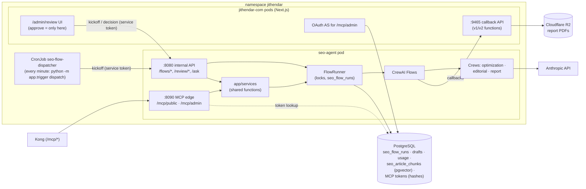
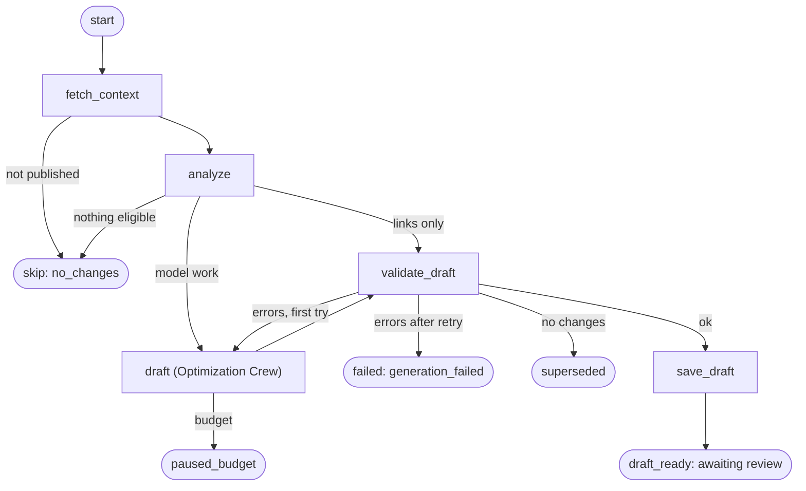
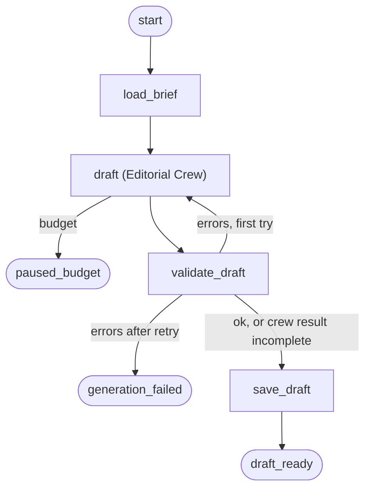
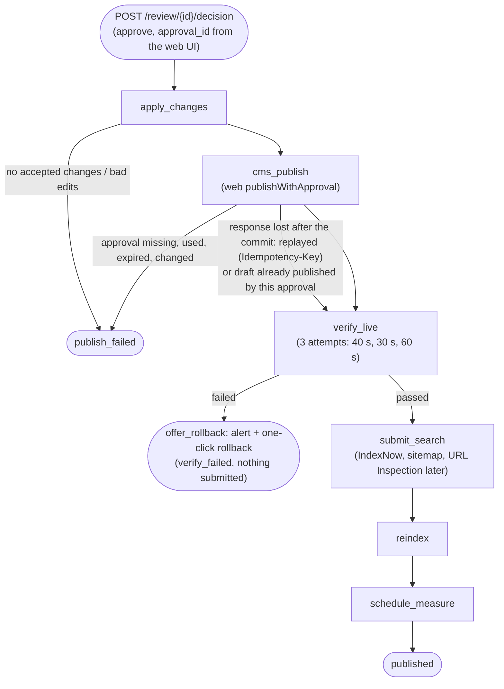
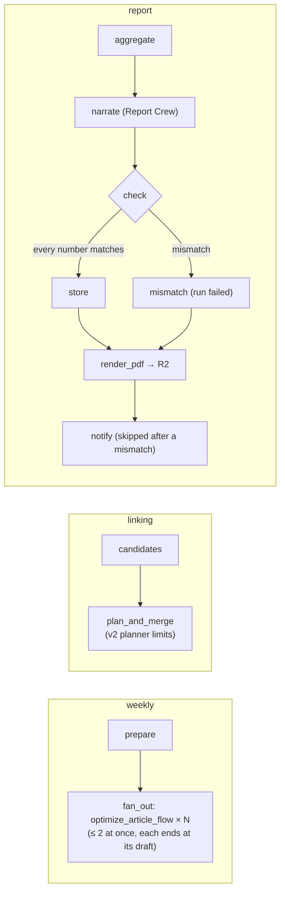
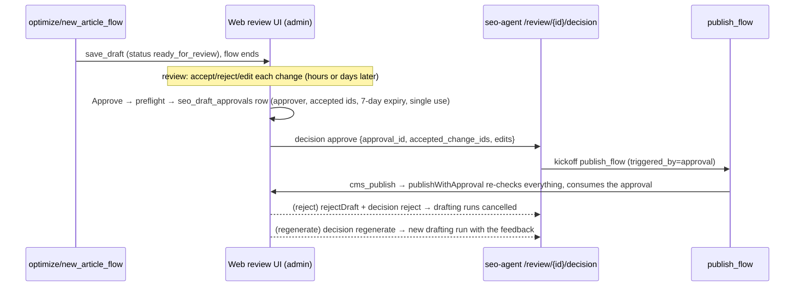

# SEO v4: CrewAI Flows (the only agent and job engine)

Every AI workflow and every scheduled SEO job runs as a **CrewAI Flow** (crewai 1.15.30) in `moks-seo-agent`.
Flows orchestrate; **Crews** do the multi-agent steps ([CREWS.md](CREWS.md)); plain Python steps do the data work
(sync, scoring, crawling) without a model. There is no other workflow engine: no LangGraph, LangChain, n8n, Airflow,
Temporal or Celery. Kubernetes CronJobs only **trigger** flows. The MCP servers ([MCP.md](MCP.md)) are an interface
onto the same service functions and the same kickoff, never a second orchestrator.

Related: [CREWS.md](CREWS.md) · [MCP.md](MCP.md) · [RAG.md](RAG.md) · [COSTS.md](COSTS.md) ·
[MANUAL_SETUP.md](MANUAL_SETUP.md#v4-crewai-flows-mcp-report-pdfs) · [DECISIONS.md](DECISIONS.md) D-54 onward.

## Flows and crews in the admin (D-100)

Every flow and crew of the agent is also a row of the admin's catalogue (moks-cms `crewai_flows` / `crewai_crews`,
migration 0041), next to the ones made in the admin. The admin can rename, recategorise, retag, switch off, delete or
duplicate any of them; a code flow switched off there is refused by the runner (`GET /internal/seo-agent/flow-switches`,
`app/flows/switches.py`). Flows made of steps run on `custom_flow` (`app/flows/custom.py`). See [CATALOGUE.md](CATALOGUE.md).

## Finding the SEO agent

The agent is optional: it ships as its own image (`moks-tech/moks-seo-agent`). The web app looks for it and uses it only
when it answers (`src/lib/seo-agent/endpoint.ts`):

1. `SEO_AGENT_URL`, when the deployment sets it; else
2. the endpoint an admin saved in **Admin → Automation & AI → SEO agent** (setting `seo_agent`, audit-logged); else
3. discovery: `http://seo-agent:8080` (a Service named `seo-agent` in the web app's namespace, or a compose service),
   then `http://seo-agent.<namespace>.svc.cluster.local:8080` when the namespace is known (`POD_NAMESPACE`, or the
   service-account file when it is mounted).

The agent is **on** when that endpoint answers `GET /healthz` as the agent does (`{"status": "ok", "version": …}`) and
`SEO_AGENT_TOKEN` is set. Then every AI workflow and the flow-owned scheduled jobs go through the flows, and Ask the
Blog, the MCP servers, Improve and promotion runs can be used. Otherwise it is **disabled**: the web worker runs every
SEO job itself (the v2 path) and those features are off. Each web process keeps the answer for 60 s (on) or 30 s (off)
and refreshes it in the background; the card's **Check again** checks at once.

`SEO_ORCHESTRATOR` is an override, not a requirement: `legacy` switches the agent off whatever answers (rollback),
`crewai` (or `langgraph`) switches it on without probing. Leave it unset to use discovery. The callback listener on the
web pods (port 9465) runs whenever `SEO_AGENT_CALLBACK_TOKEN` is set, unless `SEO_ORCHESTRATOR=legacy`.

## Architecture



## Trigger table

| Flow | Trigger | Steps (`@start` → `@listen` / `@router`) | Ends at |
|---|---|---|---|
| `gsc_sync_flow` | CronJob daily 06:10 UTC; "Sync now" | run_job (v1 GSC sync) → record_stats | done |
| `ga4_sync_flow` | CronJob daily 06:20 UTC; "Sync now" | run_job (v1 GA4 sync) → record_stats | done |
| `tech_audit_flow` | CronJob Mon 03:00; MCP | run_job (v1 crawler + audit) → record_stats | done |
| `ask_gaps_flow` | CronJob Mon 04:30 | cluster (unanswered questions → "Asked on site" content gaps) | done |
| `weekly_recommendations_flow` | CronJob Mon 07:00; "Run now" | prepare (freshness → rules → scoring → top N without an open draft → reserve drafts) → fan_out (≤ 2 `optimize_article_flow` at once) | done |
| `optimize_article_flow` | weekly flow; "Draft/Fix with Claude"; keyword actions; regenerate; MCP | fetch_context → analyze → draft (**Optimization Crew**) → validate_draft → router: ok → save_draft · retry once → draft · fail → failed | **draft awaiting review** |
| `internal_linking_flow` | CronJob Mon 09:00; MCP | candidates (pgvector + shared queries) → plan_and_merge (v2 planner, every limit in code) | drafts updated |
| `new_article_flow` | approved calendar idea; regenerate; MCP | load_brief → draft (**Editorial Crew**) → validate_draft → router: ok → save_draft · retry once · fail | **draft awaiting review** |
| `publish_flow` | **only a human approval** (`POST /review/{id}/decision`) | apply_changes → cms_publish → verify_live → router: passed → submit_search → reindex → schedule_measure · failed → offer_rollback | done |
| `reindex_flow` | CronJob Sun 03:17; after each publish (inside publish_flow) | chunk_and_embed (incremental by content hash) | done |
| `seo_ml_flow` (v5) | CronJob `seo-flow-ml` Sun 04:47; ML models → Run now | decay → query_clusters → intent → priority → related → rag_eval → finish (each step independent; the run fails if any failed) | done ([ML.md](ML.md)) |
| `report_flow` | CronJob Mon 08:00 (weekly) and the 2nd 08:00 (monthly); "Generate"; MCP | aggregate → narrate (**Report Crew**) → router check: store · mismatch → render_pdf (R2) → notify | done |
| `promotion_flow` | CronJob `seo-flow-promotion` daily 07:40 UTC; Promotion → "Find opportunities" / "Re-score and draft posts" | collect (web: Reddit read, channel scores) → draft (**Promotion Crew** copywriter) → save | **drafts awaiting a person** ([PROMOTION.md](PROMOTION.md)) |
| `content_ideas_flow` | CronJob `seo-flow-content-ideas` Tue 05:20 UTC; Promotion → "Suggest content ideas" | collect_signals (web: Search Console demand, Reddit threads) → ideate (**Promotion Crew** strategist) → save (evidence verified by the web app) | **ideas awaiting a person** |

"CronJob" in this table means the flow's built-in schedule: since D-98 (2026-11-19) the times are rows in the database,
edited in CrewAI console → Schedules and started by one dispatcher (see [Scheduling](#scheduling)). "Run now" buttons,
CrewAI console → Run with parameters and the MCP `kickoff_flow` tool call the same `POST /flows/{name}/kickoff` endpoint.

## The flows

All diagrams show method names; router labels carry a `to_` prefix in code (CrewAI 1.15 refuses a label equal to a
method name). Network steps retry transient errors only (connection, timeout, 429, 5xx) three times with backoff.

### optimize_article_flow



`validate_draft` runs the web app's v2 validators (block exists, `before` matches exactly once, code untouched, no
invented URLs, lengths…) and adds the planner's internal links. The technical reviewer's `needs_fact_check` items become
flags the reviewer sees. `save_draft` is the only write: the change set on the draft, every change `pending`.

### new_article_flow



An incomplete crew result is still saved (marked incomplete, approval blocked by its error flags): a partial draft is
more useful to the reviewer than nothing.

### publish_flow



### weekly_recommendations_flow, internal_linking_flow, report_flow



The job flows (`gsc_sync_flow`, `ga4_sync_flow`, `tech_audit_flow`) are `run_job → record_stats` around the v1 job
runner, which keeps its own lease, `seo_sync_jobs` row and metrics. A scheduled run passes a dated slot; the web app
skips a job type whose scheduled run for that slot already exists, so the CronJob and (before switching) the in-process
scheduler can never both run it.

## The human gate: split-flow approval (D-56)



Nothing waits in memory: a drafting flow **ends** at `ready_for_review` with its final state in `seo_flow_runs`.
Approval starts a new flow. This survives restarts and redeploys. CrewAI's `@human_feedback` exists in 1.15 but holds a
flow open (persisted) until feedback arrives; the split pattern was chosen instead because the approval must be recorded
and re-checked by the web app (v3 D-43), and nothing should depend on a paused run.

Guarantees (all tested):
- No drafting flow, crew, tool or MCP module calls the web app's publish/verify/submit callbacks; only
  `flows/publish.py` does (static test over the source).
- `publish_flow` is refused by the run manager for every trigger except `approval`, which only the decision endpoint sets
  (`POST /flows/publish_flow/kickoff` → 403; MCP `kickoff_flow("publish_flow")` → refused).
- The web app publishes only for an unused, unexpired approval for this draft with exactly these accepted change ids, an
  approver who is still an admin, and edits equal to what the review UI stored.

## State and persistence

Typed Pydantic state per flow (`app/state.py`); every input is validated against a strict model first (extra fields
refused, bounded sizes, UUID patterns).

| State | Fields (besides `id`, `triggered_by`, `outcome`, `errors`, `cost_usd`, `tokens`) |
|---|---|
| `JobState` | job_type, slot, result |
| `WeeklyState` | limit, prepared, children |
| `OptimizeState` | draft_id, article_id, recommendation_ids, extra, trigger, feedback (reviewer), validator_feedback (automatic retry), context, related, plan, change_set, crew, changes, validation_report, attempts |
| `LinkingState` | article_ids, candidates, results |
| `NewArticleState` | draft_id, calendar_id, article_id, feedback (reviewer), validator_feedback (automatic retry), brief, document, crew, changes, validation_report, attempts |
| `PublishState` | draft_id, article_id, approval_id, accepted_change_ids, edits, actor, publish_result, verification, submission_results, reindex, measurement |
| `ReindexState` | article_ids, full, result |
| `AskGapsState` | result |
| `ReportState` | period, report_id, numbers, narrative, check, crew, pdf, notified |
| `PromotionState` | article_id, limit, reddit, articles, drafts, results, result |
| `ContentIdeasState` | reddit, signals, ideas, crew, result |

`seo_flow_runs` (web migration 0016): run_id, flow_name, target_id, draft_id, status (queued · running · succeeded ·
failed · cancelled · paused_budget), current_step, state_json, inputs, outputs, error, tokens, cost_usd, started_at,
finished_at, updated_at, triggered_by (cron · manual · approval · flow · mcp), correlation_id, actor.

- **Persistence:** `PgFlowPersistence` implements CrewAI's `FlowPersistence` and writes the state, step, tokens and cost
  into the run's row after every step (CrewAI calls it synchronously; a 2-connection sync pool). CrewAI's default SQLite
  persistence is never used: every flow class is decorated with `@persist(INSTANCE_ONLY)`, a backend that refuses to
  work, and each instance gets the Postgres one. Flows also skip CrewAI's auto-created memory (`_skip_auto_memory`; it would need LanceDB, which is not installed, D-103).
- **One active run per flow + target:** a partial unique index (`flow_name, target_id` where queued/running) refuses a
  second row; a Postgres **session advisory lock** on a dedicated connection is held for the whole run (a dead pod's
  connection closes and releases it). A second kickoff returns the existing run (`existing: true`).
- **Failures:** a step that raises marks the run `failed` with the error. A rerun starts from the beginning; steps are
  idempotent (upserts, one open draft per article, single-use approvals). On start-up, runs the previous process left
  queued/running are failed ("interrupted by a restart") and their drafts set to "regenerate".
- **Wall clock:** `SEO_FLOW_TIMEOUT_SECONDS` (1800) per run; crews have their own shorter limit. A cancelled or timed-out
  run also stops its crew: the crew's worker thread makes no further model call (CREWS.md "Cancellation").
- **Publish retries:** `cms_publish` sends the approval id as `Idempotency-Key`. If a publish commits and its response is
  lost (timeout, 5xx), the retry gets the earlier success back from `publishWithApproval` (`replayed: true`) instead of a
  403 for the used approval. Against a web app without that, a non-transient error after a transient one makes the flow
  read the draft (`GET /drafts/{id}`): `published` by this approval (`publishedApprovalId`) counts as success.

## Run history (CrewAI console)

Admin → AI room → **CrewAI console** (`/admin/crewai`, D-97) shows every run like a GitHub Actions run: a number per
flow, the steps, a log grouped by step, the model calls with their transcripts, the cost per agent and model, the
runs it started, and Re-run / Cancel. Web migration 0036:

| Table | Written by | What |
|---|---|---|
| `seo_flow_runs.run_number` | a `BEFORE INSERT` trigger (`seo_flow_run_counters`, `SECURITY DEFINER`) | `#N` per flow; a refused second active run takes no number |
| `seo_flow_run_steps` | `SeoFlow.step()` (seo-agent/app/flows/base.py) | one row per step: running → succeeded · failed · cancelled, seconds, error |
| `seo_flow_run_logs` | `RunLogHandler` (seo-agent/app/run_history.py) | the agent's own log records that belong to the run, written in batches every 0.5 s |
| `seo_flow_run_calls` | `RecordingLlm` (same file) | each model call's system prompt, prompt and answer, while Run history → transcripts is on |

- **Which lines:** a record belongs to a run when `CURRENT_RUN_ID` is set or the record carries `run_id` (crew worker
  threads pass it with `extra=`). Its step is the one it names, else the step running in its task, else the run's open
  step (worker threads do not inherit context variables). Library INFO lines (httpx, psycopg, anthropic) are kept at
  debug. At most 20,000 lines a run; the rest stay in Loki only. Lines still go to stderr → Loki as before.
- **Model calls:** every call of a flow run gets a `llm_call` line (agent, model, tokens, cost, seconds, outcome). The
  transcript is stored while the setting is on (read through `GET /internal/seo-agent/run-history/settings`, cached
  60 s; on when it cannot be read). Ask the Blog calls carry no run and are not recorded.
- **Never breaks a run:** writes are best effort; with the tables missing or not granted (scripts/db-role.sql) nothing
  is written. A run that ends with a step still open closes it (cancelled, or failed).
- **Retention:** the daily `retention` job deletes log lines older than `runHistory.logRetentionDays` (90) and
  transcripts older than `runHistory.transcriptRetentionDays` (14). Runs, steps and cost stay.
- **Re-run** calls `POST /flows/{flow}/kickoff` (`triggered_by=manual`, the admin as actor) with the run's inputs or
  edited ones (the agent validates them). Not offered for drafting flows (Regenerate in the review queue), publish_flow
  (approval only), the news dispatcher (cron) and per-story news runs (the news run page). Cancel calls
  `POST /flows/runs/{id}/cancel`.

## Scheduling

Schedules are rows in `seo_flow_schedules` (web migration 0037, D-98), edited in **CrewAI console → Schedules**
(`/admin/crewai/schedules`): a name, the flow, a 5-field cron in an IANA time zone, the inputs the run gets, and a
switch. One CronJob (`seo-flow-dispatcher` in the site repository's `kubernetes/seo-agent-60-dispatcher.yaml`, every
minute) runs `python -m app.trigger dispatch`: one authenticated `POST /schedules/dispatch`, then `/quitquitquit`. The
agent (moks-seo-agent `app/schedules.py`) then, for each enabled schedule:

- takes the latest fire time within the catch-up window (`SCHEDULE_CATCHUP_MINUTES`, 60) that is after `armed_at`.
  The web app moves `armed_at` when the cron, time zone or switch changes, so a new or edited schedule never fires a
  time that has already passed; missed times are not replayed one by one (like `concurrencyPolicy: Forbid`);
- claims that slot (`20261119T0610Z`) with one conditional `UPDATE … where last_slot < slot`, so a retried CronJob, a
  second call or a second pod starts it once;
- starts the flow through `FlowRunner.kickoff(triggered_by="cron", actor="schedule:<name>")` with the schedule's
  inputs (checked by the flow's input model) and writes the outcome back: `last_status` started · already_running (a
  run of the same flow and target was going) · failed, `last_run_id`, `last_error`.

Only `CRON_FLOWS` can be scheduled (the agent refuses `triggered_by=cron` for any other flow). The fifteen built-in
schedules (`builtin`, the times the per-flow CronJobs had until 2026-11-19) can be edited, paused and reset to
`default_*`, not deleted; admins add their own. The agent may write only the `last_*` columns (`scripts/db-role.sql`).
Without the table the dispatcher answers 503 and starts nothing. Pause everything with
`kubectl -n jithendar patch cronjob seo-flow-dispatcher -p '{"spec":{"suspend":true}}'`. While the agent is on the web app's
in-process scheduler skips these job types (`FLOW_OWNED_JOBS`): gsc_sync, ga4_sync, technical_scan, recommendations,
drafts_weekly, drafts_poll, report_weekly, report_monthly. Keywords refresh, retention, outcomes and the digest stay in
the web worker (they are not AI workflows and the brief lists no flow for them).

## Internal API (seo-agent :8080, bearer `SEO_AGENT_TOKEN`)

```
GET  /flows                         every flow: inputs as JSON Schema, schedulable, approval_only, crews
POST /flows/{flow_name}/validate    {inputs} → {inputs} as the flow would get them, or 422
POST /flows/{flow_name}/kickoff     {inputs, triggered_by: cron|manual, actor?} → {run_id, status, existing}
POST /schedules/dispatch            start every schedule that is due (the dispatcher CronJob)
GET  /crews                         each crew's editable configuration as the code defines it (CREWS.md)
POST /crews/{crew}/validate         {config} → {config} as it would be stored, or 422 {issues}
GET  /flows/runs                    ?flow=&status=&draft_id=&limit=
GET  /flows/runs/{run_id}           status, current_step, outcome, outputs, error, tokens, cost (+ state)
POST /flows/runs/{run_id}/cancel
POST /review/{draft_id}/decision    {approve|reject|regenerate, approval_id, accepted_change_ids, edits, feedback}
POST /ask                           Ask the Blog (proxied by the web app's rate-limited /api/ask)
GET  /budget · /healthz · /readyz · /metrics
```

The web app's `/api/admin/seo/*` routes proxy to these through `src/lib/seo-agent/client.ts` and `orchestrate.ts`; the v2
review UI is unchanged (it reads the latest `seo_flow_runs` row for a draft).

## Operations

- <a id="failed-runs"></a>**Failed runs:** the CrewAI console (`/admin/crewai/runs?status=failed`) shows the failed
  step, its log and the model calls; Sync history and MCP `list_flow_runs(status=failed)` show the error; the
  state is kept in `state_json`. Fix the cause and rerun (Re-run, Run with parameters, the schedule's Run now, or for drafts
  "Regenerate"). Alert `SeoFlowRepeatedFailures`.
- **Stale flows:** `SeoFlowStale` fires when a flow hasn't succeeded within twice its schedule (from
  `seo_flow_last_success_timestamp_seconds`). Check the schedule's Last column in CrewAI console → Schedules,
  `kubectl -n jithendar get cronjob seo-flow-dispatcher` (and its last Jobs' logs) and the last runs.
- **Restarts:** since D-105 the agent is a container of every site pod (2–8 with KEDA), so several agents run at once.
  A run executes in the agent that started it; when that pod stops, any other agent fails the run within a minute
  ("interrupted by a restart", once its advisory lock is free); rerun it. A cancel that reaches another pod stops the
  run where it runs within 5 s (app/runs.py).
- **Cancel:** the review page's run strip or `POST /api/admin/seo/agent/runs/{draftId}/cancel`.
- **Metrics:** `seo_flow_runs_total{flow,status}`, `seo_flow_duration_seconds{flow}`, `seo_flow_step_duration_seconds{flow,step}`,
  `seo_crew_runs_total{crew,status}`, `seo_llm_tokens_total{model,purpose}`, `seo_llm_cost_usd_total{purpose}`,
  `seo_drafts_awaiting_review`, `seo_flow_last_success_timestamp_seconds{flow}`, `seo_ask_requests_total{outcome}`,
  `seo_embeddings_reindex_chunks_total`, `seo_mcp_requests_total{server,tool,status}`, `seo_mcp_auth_failures_total{server}`,
  `seo_mcp_request_duration_seconds{server,tool}`, budget ratios. All labels come from fixed sets.
- **Tracing:** OTel spans `flow.<flow>.<step>` and `crew.<name>` to the existing collector → Jaeger. CrewAI's own
  telemetry and tracing are off (`CREWAI_DISABLE_TELEMETRY`, `CREWAI_DISABLE_TRACKING`, `CREWAI_TRACING_ENABLED=false`,
  `suppress_flow_events`, `tracing=False`).

### Resources

| | |
|---|---|
| Production virtualenv | 161 locked packages (v3: 177): LangGraph/LangChain removed; anthropic 2.3.0, mcp 1.30.0, reportlab 5.1.0 added |
| Model | 127 MB (bge-small-en-v1.5 ONNX, 384 dimensions) |
| Image | v3 estimate ~0.7 GB; v4 drops the LangChain family and adds ReportLab (pure Python, ~4 MB). CI reports the real size; no container runtime here |
| Idle RSS / reindex peak | ~310 MiB / ~700 MiB (v3 measurements; the flows add no resident model) |
| Requests / limits | 250m / 768Mi and 1 CPU / 1280Mi; trigger pods 10m / 48Mi |
