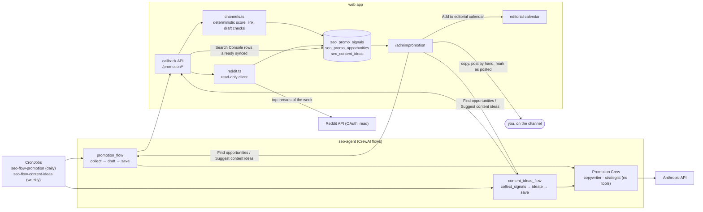

# Promotion: where to share articles, drafted posts, content ideas

Admin → **Promotion** (`/admin/promotion`, admins only). Two jobs:

1. **Existing articles.** For every published article, a score per channel with its reasons, a link tagged for that
   channel, and a post drafted by Claude in that channel's style. You edit it, copy it, post it yourself, and mark it
   as posted.
2. **New articles.** Content ideas chosen because people are already searching for or discussing the subject and the
   site has no article on it. Every idea lists its evidence. One click sends an idea to the editorial calendar, where
   the existing flow takes over (schedule → draft post → Editorial Crew → your review).

**Nothing is ever posted automatically.** There is no code path that posts to a channel: the Reddit client only reads,
the crew's agents have no tools, and "Mark as posted" only records what you did. AI output is text waiting for a person
(AGENTS.md A3.10).

Related: [FLOWS.md](FLOWS.md) · [CREWS.md](CREWS.md) · [MANUAL_SETUP.md](MANUAL_SETUP.md#37-promotion-reddit-api-app-and-the-promotion-cronjobs)
· [DECISIONS.md](DECISIONS.md) D-88.

## How it works

The seo-agent has no internet egress except the Anthropic API, so the web app reads Reddit, exactly as it fetches news
feeds for the news desk. The model only writes text; which channels, the scores, the links and the evidence checks are
plain code in the web app.

## Channels

`linkedin`, `reddit`, `hackernews`, `facebook` (groups), `x`, `devto`, `hashnode`, `newsletter` (submission blurb for
curated newsletters). Each has a length limit, a note on where the link goes and writing guidance
(`src/lib/seo-intel/promotion/channels.ts`); the guidance is sent to the copywriter and shown next to the draft. All
are on by default; switch any off under Promotion → Settings.

## The opportunity score

A number from 0 to 100 per article and channel. It **orders channels and explains itself; it is not a forecast** of
traffic. Every reason shown comes from data the site holds.

| Part | Rule |
|---|---|
| Base | linkedin 60, devto 50, reddit 45, hashnode 45, facebook 40, x 40, hackernews 35, newsletter 35 |
| Freshness | published ≤ 14 days ago +10; more than 180 days ago −10 |
| Search traction | +1 per 10 Search Console clicks in the last 28 days, up to +15 |
| Reddit | +15 with one matching thread this week in the configured subreddits, +25 with three or more |
| Hacker News, LinkedIn | +15 / +10 when the title reads as a first-hand account (migrated, replaced, what broke, lessons, benchmark…) |
| DEV, Hashnode, Facebook | +10 for a tutorial or how-to; DEV and Hashnode −10 under 500 words |
| Newsletter | +15 for an article of 1,200+ words in a Kubernetes / DevOps / SRE / platform category |

Bands: high ≥ 70, medium ≥ 50, low below. Channels scoring at least `minScore` (default 40) get a draft; the rest are
listed under Opportunities, where you can write one yourself. A thread "matches" when its title shares at least two
subject words with the article's title and tags.

## Drafts and their checks

The copywriter writes one post per channel from the article's title, description, opening text and top Search Console
queries. It is told to use only what the article says, write in the first person, follow the channel's guidance and use
the tagged link exactly. The web app then checks every draft (and every edit you save) and shows the result as "Check:"
lines; they never block you:

- longer than the channel's limit (X 280, Hacker News title 80…);
- a link that is not to this site (other than a Reddit thread listed as evidence);
- the article link missing where it belongs in the text, or present where it does not (LinkedIn: first comment;
  Hacker News: URL field).

Statuses: `open` (scored, no draft) → `drafted` → `posted` (you recorded it, optionally with the post's URL) or
`dismissed`. A draft you edited is never overwritten by a later run; posted and dismissed rows are never redrafted.
"Re-score and draft posts" on an article redoes its scores and its unedited drafts.

## Tagged links

Each channel's link is the article URL with `utm_source=<channel>`, `utm_medium` (default `social`) and
`utm_campaign` (default `promotion`). GA4 attributes those visits to the source; look under Acquisition in GA4. The
admin does **not** show traffic per promotion yet: the GA4 sync stores channel groups, not `utm_source` (see "Not in
this version").

## Content ideas

`content_ideas_flow` gives the strategist only:

- **Search Console topics**: the Keywords page's content gaps (query clusters with demand and no page ranking above
  position 15);
- **Search Console queries**: 28-day queries with at least 30 impressions at average position 8 to 30;
- **Reddit threads**: the top threads of the week from the configured subreddits (title, score, comments, URL);
- what is already **covered** (published titles) and **planned** (calendar items and earlier ideas, including
  dismissed ones).

Each idea must cite evidence copied from those signals. When the ideas come back, the web app looks every item up in
its own data: a query or topic that is not in the signals, or a thread that was not fetched, is dropped, and an idea
left with no evidence is not stored. Ideas on a subject the site has published or planned are skipped. The idea score
(0 to 100) uses verified evidence only: 20 + up to 40 for impressions (1 per 25) + up to 30 for threads (10 each, plus
1 per 50 upvotes) + 10 when both kinds are present.

Actions: **Add to editorial calendar** (an approved item with the angle as "gap", the outline and the supporting
queries in its brief, and the evidence in its notes), **Save for later**, **Dismiss** (kept, so it is not suggested
again), **Restore**.

## Reddit

Read-only, application-only OAuth with the credentials of a "script" app. One request per configured subreddit per run
(`/r/<name>/top?t=week`), with the descriptive User-Agent Reddit asks for. Stored per thread: id, subreddit, title,
permalink, score, comment count, time. **Not stored:** usernames, post bodies, comments. Titles that look like they
contain an email address, a phone number or a secret are dropped. Stickied and adult posts are skipped, as are threads
under `redditMinScore` upvotes. Rows older than 60 days are pruned.

**Requires manual configuration:** `REDDIT_CLIENT_ID`, `REDDIT_CLIENT_SECRET` (and optionally `REDDIT_USER_AGENT`) in
the Secret `jithendar-com-env` (`scripts/set-reddit-config.sh`). Without them the page says so, the flows report
`reddit: not_configured`, and everything else works from the articles and Search Console data. A failing Reddit call
never fails a run. Check Reddit's current API terms and limits when you create the app; this integration needs only
free, read-only access at a few requests per day.

## Flows and schedule

| Flow | Trigger | Ends at |
|---|---|---|
| `promotion_flow` | CronJob `seo-flow-promotion`, daily 07:40 UTC (newest published articles without opportunities, `articlesPerRun` at a time); "Find opportunities"; "Re-score and draft posts" (one article) | drafts awaiting you (`drafts_ready`), or `no_drafts_needed`, `disabled`, `paused_budget` |
| `content_ideas_flow` | CronJob `seo-flow-content-ideas`, Tuesdays 05:20 UTC; "Suggest content ideas" | ideas awaiting you (`ideas_ready`), or `no_ideas`, `no_signals`, `disabled`, `paused_budget` |

Both are ordinary CrewAI flows in `moks-seo-agent` (run records in `seo_flow_runs`, shown in Data sync; one active
run per flow and target; the monthly Claude budget applies, purpose `crew`). They are not on the admin MCP allowlist.
The buttons need `SEO_ORCHESTRATOR=crewai`. Manifest: `kubernetes/seo-agent-62-promotion-triggers.yaml`, applied by a
person with the seo-agent group.

## Data (migration `0027_seo_promotion.sql`, additive)

| Table | Key | Notes |
|---|---|---|
| `seo_promo_signals` | (`source`, `external_id`) | Reddit threads: community, title, url, score, comments, posted_at, fetched_at |
| `seo_promo_opportunities` | (`article_id`, `channel`) | score, reasons, evidence (words, clicks, threads), link, status, draft title/body/notes/flags, edited_by, posted_url, posted_at |
| `seo_content_ideas` | `fingerprint` (the title's sorted words) | title, angle, outline, target_query, channels, signals (verified evidence), score, source, status, calendar_id |

Settings: `setting` row `promotion` (no credential in it). Rollback: `src/db/rollback/0027_seo_promotion.down.sql`.

## API (`/api/admin/seo/promotion/…`, admin only, the same guard as every SEO route)

| Method | Path | Purpose |
|---|---|---|
| GET | `promotion` | counts, opportunities by article (`status`, `articleId`), ideas (`ideas=dismissed\|sent`), Reddit state, settings |
| POST | `promotion/run` | `{ kind: "opportunities", articleId? }` or `{ kind: "ideas" }`: start the flow (10 per 10 min) |
| PATCH | `promotion/opportunities/{id}` | `{ action: save \| posted \| dismiss \| reopen, title?, body?, postedUrl? }` |
| PATCH | `promotion/ideas/{id}` | `{ action: calendar \| save \| dismiss \| restore }` |
| GET, PUT | `promotion/settings` | the settings document |
| POST | `promotion/reddit/test` | one real read-only request (6 per 10 min) |

Every mutation is audit-logged (`seo.promotion.*`). Callback routes for the agent (cluster-internal, token):
`POST /promotion/collect`, `/promotion/articles/{id}/drafts`, `/promotion/ideas/signals`, `/promotion/ideas`.

## Settings

| Setting | Default | Meaning |
|---|---|---|
| `enabled` | on | off: the flows do nothing and the page says so |
| `channels` | all on | channels that are scored and drafted |
| `subreddits` | kubernetes, devops, sre, aws, Terraform, mlops, platformengineering | read for threads (at most 15) |
| `redditMinScore` | 10 | minimum upvotes for a thread to count |
| `minScore` | 40 | channels below this get no draft |
| `articlesPerRun` | 3 | new articles per scheduled run |
| `ideasPerRun` | 8 | ideas asked for per weekly run |
| `utmMedium`, `utmCampaign` | social, promotion | on the tagged links |

## Not in this version

- **Posting through an API.** DEV, Hashnode and LinkedIn have posting APIs; this version drafts and you post. Reddit,
  Hacker News and Facebook groups stay manual on purpose: automated posting there breaks their rules.
- **Traffic per promotion in the admin.** Needs a GA4 report by `sessionSource` in the GA4 sync.
- **Hacker News as a signal.** Only Search Console and Reddit feed the ideas.
- **Alerts and a Grafana panel** for the two flows. Their runs are counted by the existing
  `seo_flow_runs_total{flow,status}` metric.

## Strategies (2026-11-18, owner request)

"Improve content promotion, add different strategies to promote content." The Strategies tab
(`src/lib/seo-intel/promotion/strategies.ts`, `promotionPlan`) computes, from data the site already has, seven
strategies and the articles each applies to now. Every action ends in drafts or links for a person; nothing is posted.

| Strategy | Applies to | Action |
|---|---|---|
| Launch | Published in the last 14 days | Draft posts (promotion_flow for the article) |
| Evergreen reshare | Older than 60 days, ≥ 10 search clicks in 28 days, not shared for 90 days | Reshare: `POST /api/admin/seo/promotion/reshare` reopens channels posted over 90 days ago (posted URL and date kept, dismissed channels untouched) and drafts again |
| Refresh, then reshare | Search clicks down ≥ 30% (previous 28 days ≥ 20) | Refresh first: an optimisation draft with freshness and title/meta tasks in the review queue |
| Syndicate | Older than 7 days, not posted on dev.to or Hashnode | The article's dev.to / Hashnode drafts, canonical URL shown |
| Community answers | Reddit threads matched to an article in the last 30 days | Open the thread |
| Internal links | Suggested internal links to articles from the last 45 days | Internal linking |
| Newsletter digest | This week's articles plus the top evergreen pick | A ready issue to copy, links with utm_source=newsletter |

