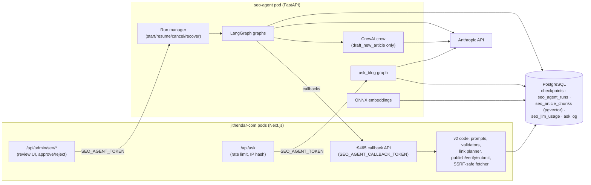
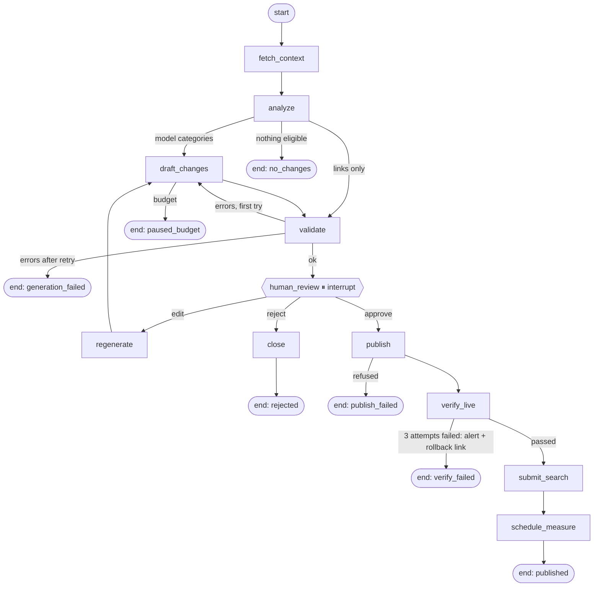
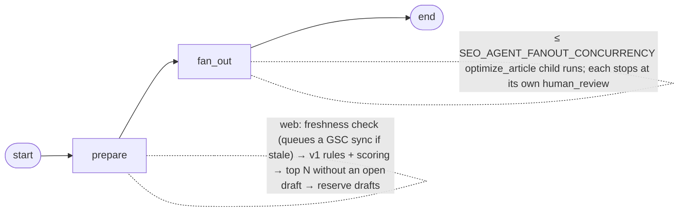
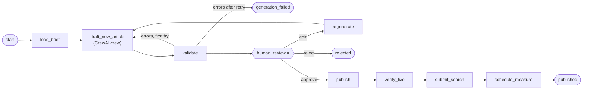

# SEO v3: agents (LangGraph, CrewAI, pgvector)

v3 moves the AI workflow of the SEO platform onto **LangGraph**, running in a separate Python service,
`services/seo-agent`. **CrewAI** is used inside exactly one node, to draft new articles. Retrieval uses **pgvector** in
the existing PostgreSQL. The human approval gate is unchanged: nothing an agent does can publish, edit live content or
call a submission API. Publishing happens only when an admin's approval, recorded by the web app, resumes a graph.

Related: [RAG.md](RAG.md) (Ask the Blog, embeddings), [COSTS.md](COSTS.md), [MANUAL_SETUP.md](MANUAL_SETUP.md#v3-agents-langgraph-crewai-pgvector),
[DECISIONS.md](DECISIONS.md) D-41 onward.

## Architecture

- **One orchestrator:** LangGraph. CrewAI runs only inside the `draft_new_article` node (no Flow, memory, planning or
  delegation). There's no other queue or scheduler. Runs execute as tasks in the single `seo-agent` replica, and the
  weekly trigger is the web app's existing `drafts_weekly` schedule. The reindex runs as a CronJob.
- **One database:** the existing PostgreSQL holds LangGraph's checkpoints (`checkpoints`, `checkpoint_blobs`,
  `checkpoint_writes`, `checkpoint_migrations`, created by `AsyncPostgresSaver.setup()`), the run summaries
  (`seo_agent_runs`), the vectors (`seo_article_chunks`), usage (`seo_llm_usage`, shared with v2) and the Ask log.
- **No reimplementation:** every v2 function (prompt building, change-set validation, the internal-link planner,
  publish, live verification, IndexNow and sitemap submission, the SSRF-safe fetcher) is called through the web app's
  callback API.
- **Cluster-internal:** `seo-agent` has only a ClusterIP Service. The callback API listens on its own port (9465) on
  the web pods. The VirtualService routes only port 80/3000, and NetworkPolicies admit only the expected callers.

### Orchestrator switch and rollback

`SEO_ORCHESTRATOR` controls which path runs.

- `legacy` (the default) is v2 unchanged: the job queue, Message Batches and the direct Claude path.
- `langgraph` sends "Draft with Claude", "Fix with Claude", keyword actions, regeneration, approval, rejection,
  scheduled publishing and the weekly run through `seo-agent`.

Each draft remembers which path owns it (`seo_drafts.thread_id`), so switching never strands a draft. A legacy draft
keeps the legacy approve path even in `langgraph` mode. **Rollback** = set `SEO_ORCHESTRATOR=legacy` (and
`ASK_BLOG_ENABLED=false`), then restart the web pods.

## Graphs

All graphs are compiled with `AsyncPostgresSaver`, apart from `ask_blog`, which is stateless. Every node is wrapped for
a duration histogram, an OTel span and a `current_node` update on the run record. Nodes that call the network have a
retry policy (3 attempts, exponential backoff with jitter) for transient errors only: connection errors, timeouts,
429 and 5xx.

### optimize_article (thread id = draft id)

| Node | Does | Calls |
|---|---|---|
| `fetch_context` | Article, v2's own prompt for it (rules, style guide, article blocks, recommendations, 28-day queries), GA4 engagement, metrics snapshot, and related articles from pgvector | `POST /articles/{id}/context`; pgvector |
| `analyze` | Picks the recommendations and categories. Skips the model when only links are needed | none |
| `draft_changes` | `ChatAnthropic(SEO_DRAFT_MODEL).with_structured_output(ModelChangeSet)`; rules + style guide as cached system blocks; feedback on retry | Claude |
| `validate` | v2 `toChanges` + planner links + `validateChangeSet`. One automatic retry with the errors as feedback, then `generation_failed`. On success the **only write: the draft** (`/drafts/{id}/save`, all changes `pending`) | callbacks |
| `human_review` | `interrupt({draft_id, summary, changes, validation_report, cost})`. No side effects, because it re-runs on resume | none |
| `regenerate` | Reviewer feedback → draft again | status callback |
| `publish` | `/drafts/{id}/publish {approvalId, acceptedChangeIds}` → v2 `publishDraft` through the CMS's own update path | callback |
| `verify_live` | 3 attempts (40 s, 30 s, 60 s delays). On the final failure the web app audits and sends the alert with the one-click rollback link | callback |
| `submit_search` | v2 `submitAfterPublish` (batched IndexNow, sitemap resubmit, URL Inspection later), then an incremental reindex of the article | callback; pgvector |
| `schedule_measure` | Records that the web app's daily `outcomes` job captures the +28/+56-day metrics | none |

**State** (`optimize_article.State`): `thread_id`, `draft_id`, `article_id`, `recommendation_ids`, `extra`, `trigger`,
`context`, `metrics_snapshot`, `related`, `plan`, `change_set`, `changes`, `validation_report`, `attempts`,
`feedback`, `review_decision`, `publish_result`, `verification`, `submission_results`, `measurement`, `status`,
`errors` (appended) and `cost_usd` (summed).

### weekly_recommendations (thread id = `weekly:<ISO week>`)

The weekly thread id makes the run idempotent per week. Restarting `fan_out` after a crash doesn't start an existing
child thread again. Message Batches aren't used inside graphs (see D-46).

### internal_linking

`candidates` combines pgvector article similarity (0.65) with the Jaccard overlap of the Search Console queries both
pages rank for (0.35). `plan` feeds those scores into v2's deterministic planner as its relevance term. Every v2 limit
still applies: at most 3 new links per article, the density cap, one link per target, nothing in headings, code, the
first sentence or existing links, and at most 5 new inbound links per target per week. The result is merged into the
article's open draft as `internal_link` changes. No model is involved.

### new_article (thread id = draft id)

It starts when an admin creates a draft from an approved content-gap idea on the editorial calendar (Calendar →
"Create draft"). The web app creates the CMS draft post (v1) and reserves a `kind = new_article` draft for it. Approving
publishes that CMS draft post through `updatePost` (status → published), only with a recorded approval.

## Interrupt and resume ↔ the review UI

| Review UI action (unchanged buttons) | Web app | Graph |
|---|---|---|
| Accept / reject / edit a change | v2 `decideChange` on the draft row | (nothing: decisions are stored before resuming) |
| **Approve & publish** | v2 preflight → `seo_draft_approvals` row (accepted ids, approver, expiry 7 days) → `POST /runs/{id}/resume {decision: approve, approval_id, accepted_change_ids}` | `publish` → callback → `publishWithApproval` |
| Approve, publish later | approval with `publish_at`; draft `scheduled`; the 30-s worker resumes the graph when it's time | as above |
| Reject (with reason) | v2 `rejectDraft`, then resume `{decision: reject}` | `close` |
| Regenerate / request changes | resume `{decision: edit, feedback}` | `regenerate` → `draft_changes` |

The review queue and the draft page read the run summary (`seo_agent_runs`: status, current node, outcome, cost) and
show it next to the v2 diff. A new-article draft opens a document view with sources and fact-check flags highlighted.

### The approval gate (D-43)

`publishWithApproval` (`services/www/src/lib/seo-intel/publish.ts`) refuses unless all of these hold:

- the approval id exists for this draft, is unused and hasn't expired
- the accepted change ids equal the approved ones
- the draft's accepted set hasn't changed since approval
- the approver is still an admin
- a scheduled approval's time has come

The approval is consumed before anything is written, so it works once. The agent has no other way to publish:
`/drafts/{id}/save` sets every change to `pending` and `/status` accepts only generation statuses. A static test
limits which modules may import the publisher and which functions may call `updatePost`.

## The editorial crew (Phase 3)

| Agent | Job | Tools (read-only) |
|---|---|---|
| Researcher | Related site articles and official docs; lists every source URL | `vector_search`, `read_article`, `fetch_allowlisted_docs` |
| Technical writer | MDX draft following `STYLE_GUIDE.md`, minimal working code | `read_article` |
| Technical reviewer | Checks commands, flags and versions against the sources; anything without a source becomes `needs_fact_check` | `fetch_allowlisted_docs` |
| SEO editor | Title ≤ 60, meta 120–155, heading plan, ≤ 3 internal links to existing paths; the final `NewArticleDraft` JSON | `gsc_queries_for_topic`, `vector_search` |

- **Process:** sequential, `memory=False`, `planning=False`, no delegation. CrewAI telemetry and tracing are off
  (`CREWAI_DISABLE_TELEMETRY`, `CREWAI_DISABLE_TRACKING`, `CREWAI_TRACING_ENABLED=false`).
- **LLM:** `ClaudeCrewLLM`, a CrewAI `BaseLLM`. It calls this service's LLM layer, so the crew uses the same budget
  guard, usage rows and prices. There's a per-agent model override (`brief.models`).
- **Limits:** `max_iter` (`CREW_MAX_ITER`, 4) and `max_execution_time` per agent; `CREW_MAX_TOKENS_PER_RUN` (150k)
  checked before every call; `CREW_TIMEOUT_SECONDS` (600) wall clock. Hitting any limit returns a **partial draft
  marked incomplete** (the reviewer's or writer's output). An incomplete draft is shown, but approval is blocked.
- **Untrusted input:** tool results are `<data>` blocks with closing tags neutralised, and every backstory says the
  data is reference material, not instructions. A cited source the crew never actually fetched during the run is
  flagged automatically.
- **Docs allowlist** (`SEO_AGENT_DOCS_ALLOWLIST`, default: kubernetes.io, docs.aws.amazon.com, developer.hashicorp.com,
  docs.python.org, langchain-ai.github.io, docs.crewai.com, modelcontextprotocol.io). It's checked in Python first, then
  fetched by the web app's SSRF-safe fetcher (https only, DNS resolved inside the socket, private ranges refused,
  every redirect re-checked).

## Tools: the complete list

`ALLOWED_TOOLS = {read_article, vector_search, gsc_queries_for_topic, fetch_allowlisted_docs}`. All four are read-only.
There's no shell, no arbitrary HTTP and no database write among them. `build_tools` refuses any other name, and tests
assert the exact sets.

## Callback API (web app, port 9465, `/internal/seo-agent`)

| Method | Path | Purpose |
|---|---|---|
| POST | `/articles/{id}/context` | v2 prompt + recommendations + metrics + GA4 |
| POST | `/articles/{id}/validate` | v2 validators (optimize) or the new-article validator |
| POST | `/articles/{id}/links` | v2 planner with semantic scores → merged into the open draft |
| GET | `/articles/read?ref=`, `/articles/published` | read-only article access (published only) |
| POST | `/drafts/{id}/save`, `/drafts/{id}/status` | the agent's only writes (own drafts only) |
| POST | `/drafts/{id}/publish` | approval-gated publish |
| POST | `/drafts/{id}/verify`, `/drafts/{id}/submit` | one verification attempt; submission only after `passed` |
| GET | `/gsc/queries?topic=\|articleId=` | 28-day aggregates, personal-data-looking queries removed |
| POST | `/fetch-docs` | allowlisted documentation through the SSRF-safe fetcher |
| POST | `/weekly/candidates` | freshness + rules + scoring + reserved drafts |
| GET | `/calendar/{id}/brief` | the content-gap idea for the crew |

A contract test (`services/seo-agent/tests/test_contract.py`) parses this route table from `internal-server.ts`
and checks every client call against it.

## Run API (seo-agent, ClusterIP :8080, bearer `SEO_AGENT_TOKEN`)

`POST /runs` · `GET /runs/{thread_id}` · `POST /runs/{thread_id}/resume` · `POST /runs/{thread_id}/cancel` ·
`POST /embeddings/reindex` · `POST /ask` · `GET /budget`. Unauthenticated: `GET /healthz`, `/readyz`, `/metrics`.

## Operations

- **Restarts:** waiting runs live in Postgres and resume whenever an admin decides. Runs that were mid-execution are
  re-driven from their last checkpoint on start (`RunManager.recover`), so finished nodes such as a model call or a
  publish aren't repeated. Deployment strategy is `Recreate` (never two pods).
- **Failed runs:** `seo_agent_runs.status = failed` keeps the error, and the checkpoint stays
  for inspection. The draft is unaffected. Regenerate from the review page, or `POST /runs/{id}/cancel`.
- **Metrics** (fixed label sets): `seo_graph_runs_total{graph,status}`, `seo_graph_node_duration_seconds{graph,node}`,
  `seo_graph_interrupts_pending`, `seo_crew_runs_total{status}`, `seo_llm_tokens_total{model,purpose}`,
  `seo_llm_cost_usd_total{purpose}`, `seo_ask_requests_total{outcome}`, `seo_embeddings_reindex_chunks_total`,
  `seo_llm_budget_used_ratio`, `seo_ask_budget_used_ratio`, `seo_llm_budget_blocked_total{scope}`.
  Dashboard: *Jithendar.com · SEO agents*. Alerts: `prometheus-alerts.yml`, group `jithendar-com-seo-agent`.
- **Tracing:** OTel spans per node (`graph.<graph>.<node>`) and for the crew (`crew.editorial`), sent to the existing
  collector (`OTEL_EXPORTER_OTLP_ENDPOINT`) and on to Jaeger. LangSmith is off. Langfuse (self-hosted) would be an
  optional alternative, but needs its own Postgres/ClickHouse and isn't set up.

### Resources

Measured on 2026-11-10 (Apple Silicon, Python 3.13, the production dependency set; Linux may differ by ±15 %):

| | |
|---|---|
| Production virtualenv | 469 MB (761 MB before dropping CrewAI's unused LanceDB/pyarrow) |
| Model | 127 MB (bge-small-en-v1.5 ONNX, 384 dims) |
| Image (estimate) | ~0.7 GB uncompressed (python:3.13-slim + venv + model). CI reports the real size; no Docker was available locally |
| Idle RSS (app + model loaded) | ~310 MiB |
| Full reindex, 37 articles / 1,243 chunks | 118 s on 2 threads; peak ~700 MiB (1,152 MiB before disabling ONNX Runtime's arena and memory patterns) |
| Incremental reindex after one publish | seconds (only changed chunks) |

The Kubernetes requests/limits are 250m/768Mi and 1 CPU/1280Mi.
