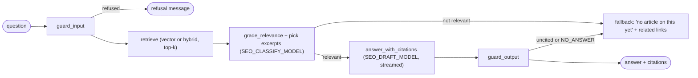

# Ask the Blog and retrieval (SEO v3, updated for v4)

A public assistant that answers **only from this site's articles**, with a citation for every statement, plus the
pgvector index the agents also use for related articles and internal links. It's **off by default**
(`ASK_BLOG_ENABLED=false`).

## Answer path (v4: a plain async pipeline)

Since v4 it is a plain async pipeline (`app/services/ask_pipeline.py`), deliberately
**not a Crew or a Flow**: a multi-agent run per visitor question would be too slow and too expensive. The same pipeline
answers the public MCP tool `ask_blog` ([MCP.md](MCP.md)), with the same guards, cache and daily budget.



- **Grounding:** the answer prompt contains only the numbered excerpts, inside a `<data>` block. The model must cite
  `[n]` for every statement or reply `NO_ANSWER`. Citations are built from the excerpts the answer actually cites, as
  `/blog/slug#heading` links. The model never writes links itself. An answer that cites nothing is treated as unknown.
- **Input guards:** at most 500 characters; mostly Latin script (the site is in English); refusal for
  prompt-injection patterns ("ignore previous instructions", "reveal/print your system prompt", "you are now", `</data>`…;
  "DAN" only in capitals, so a reader named Dan passes, and a bare "system prompt" is allowed because this blog writes
  about agents: "how do I write a system prompt for my agent?" is a fair question), personal
  data (emails, phone numbers, keys) and obvious off-topic requests. Anything else off-topic fails the relevance
  grade and gets the fallback.
- **Retrieval input:** the question is embedded as asked (whitespace collapsed). The normalized form (lower-case,
  punctuation stripped) is used only for the cache key and the gap log, because `/`, `:`, `=` and quotes carry meaning
  in technical queries.
- **Score floor:** `ASK_BLOG_MIN_SCORE` (default **0.66** since v5; was 0.15) is a cosine pre-filter on every candidate,
  applied before fusion. See "Score calibration" below.
- **Grader and answer see the same excerpt text** (1,500 characters each), so a fact the grader never saw can't be
  the reason for a fallback. Since `ask-blog-v3` the grader also returns `relevant_excerpts` (the numbers of the excerpts
  that answer the question; optional in the schema, so an older answer means "all") and the answer step gets **only
  those**, renumbered: a smaller, less noisy prompt.
- **Citations** are accepted as `[1]`, `[1][2]`, `[1, 2]` or `[1; 2]`.
- **Output guards:** links are stripped unless they point to this site or an allowlisted documentation domain.
- **Streaming:** server-sent events: `delta` events while the answer streams, then one `final` event with the guarded
  answer and citations, which replaces the streamed text in the widget. Nothing is streamed until the buffered text
  cites an excerpt that exists (`[n]`, n ≤ the excerpts sent): an uncited answer is dropped by `guard_output`, so its
  text must never have been shown, and this also holds back `NO_ANSWER`. After that, text goes out in
  whitespace-bounded pieces (never inside a URL or an unclosed `[…](…)`) with the same link stripping as the final
  answer. A truncated answer (`max_tokens`) falls back. If the reader closes the tab, the answer still finishes in its
  own task and is cached and logged (its spend is real).
- **Cost in `seo_ask_log.cost_usd`:** grader + answer (the streamed step reports its usage through `on_usage`),
  including a grader whose output didn't validate; a cache hit logs 0.

## Abuse and cost controls

| Control | Where | Default |
|---|---|---|
| Kill switch | web (`/api/ask` returns 404, no widget) and agent | `ASK_BLOG_ENABLED=false` |
| Same-origin JSON only | `/api/ask` | always |
| Per-IP limit | the existing Postgres limiter (`hit`), keyed on Envoy's `x-envoy-external-address`, otherwise the right-most `X-Forwarded-For` hop (the left-most is client-controlled) | 6/min, 60/day |
| Global limit | same limiter | 120/min |
| Daily cost cap, separate from the admin budget | agent budget guard (`purpose` `ask…`); never counts against `SEO_LLM_MONTHLY_BUDGET_USD` | `ASK_BLOG_DAILY_BUDGET_USD=1` |
| Answer cache | in-process, keyed on the normalised question + index version (any reindex changes the key) | 15 min |

Kong, the ingress and Istio routing are unchanged.

**LLM accounting (every call, `app/llm.py`):** each call is booked exactly once in `seo_llm_usage`, whatever its
ending: `ok`, `invalid` (schema miss; when the SDK raises before returning the message the row is the upper-bound
estimate, `error_code` `schema_estimated`), `truncated` (`stop_reason` `max_tokens` on text/stream: raises
`Truncated`, a subclass of `InvalidOutput`; structured output keeps `invalid` with `error_code` `max_tokens`),
`refused`, and `cancelled` (a stream closed early, e.g. a client disconnect: booked from the stream's input-token
snapshot and streamed characters ÷ 3.5, never more than `max_tokens`). Rows are priced on the model that answered
(`msg.model`; a server-side fallback can switch models; dated ids price as their family). The budget guard
**reserves** each call's upper-bound estimate (per scope, under an asyncio lock) until it is booked, so concurrent
calls can't all pass on the same spend; the reservation is in-process (the agent runs one replica). Each call also
emits one `llm.call` span (model, purpose, prompt version, token counts, `cost_usd`, outcome, `run_id`/`agent` when
the call spec carries them) and `seo_llm_calls_total{purpose,outcome}`. `run_id`/`agent` are also written to
`seo_llm_usage` once web-app migration 0022 has added the columns (checked once per process, so either side can deploy
first).

## Privacy

Questions are stored **without the IP address** (`seo_ask_log`). The web app may send a salted HMAC of the IP: the key
is derived from `BETTER_AUTH_SECRET` and the date, so it rotates daily and can't be recomputed without the secret. The
log is pruned after `ASK_BLOG_RETENTION_DAYS` (30). The widget says: "Answers come only from articles on this site.
Questions are stored without your IP address to improve the blog."

## Feedback into SEO

Fallback questions are upserted into `seo_ask_gaps` (normalised text, count, last seen). The weekly `drafts_weekly`
job clusters them with the same token-set clustering as Search Console queries. They appear in **Keyword
opportunities → Content gaps → "Asked on site"**, with their own source label, separate from GSC numbers. Questions
that look like they contain personal data are never shown. "Send to editorial calendar" creates an idea that the
crew can then draft.

## Chunking (v5: token budget)

The splitter in `services/seo-agent/app/embeddings.py` is fence-aware. It splits by h1–h3, then packs paragraphs to a
**token** budget measured with the embedding model's own tokenizer (ONNX: `tokenizer.json`; ollama/api/hash: ≈ 4
characters per token). The budget counts the **title + heading-path prefix** embedded with every chunk:

| | Tokens (prefix included) |
|---|---|
| Target | ~350 |
| Hard maximum | 480 (bge-small truncates at 512 including `[CLS]`/`[SEP]`) |
| Code window | ~400, overlapping by the previous window's last 2 lines |

- Paragraph boundaries are never inside a code block. A code block that doesn't fit stays **whole** in the stored
  `content` (what citations and the widget show) but is embedded as several **windows**, split at blank lines inside the
  block: one row per window, same heading path and anchor, `part` 0…n−1. Retrieval de-duplicates windows of one block.
  Oversized prose is split at lines, then sentences, then words.
- Each chunk keeps its heading path (`Setup › Install`) and the anchor of its heading. Anchors follow
  **rehype-slug / github-slugger**, as on the site, including `-1`/`-2` for repeated headings (a test compares them with
  the real github-slugger, and another checks the v5 chunker yields exactly v4's anchors on every article).
- Measured 2026-11-10 (36 articles, bge tokenizer): v4 made 1,221 chunks and **198 (16 %) of its embedded inputs
  were over 512 tokens**, longest 1,011, so their tails were never embedded. v5 makes 1,790 chunks, longest 471, **none
  over the limit**. Metrics: `seo_rag_chunk_tokens` (histogram) and `seo_rag_chunks_truncated_total` (must stay 0;
  alert `SeoRagChunksTruncated`).
- **Deploying v5 re-embeds every chunk once:** the chunker version is part of the stored hash, so the first reindex after
  the deploy (the weekly `seo-flow-reindex`, or `POST /api/admin/seo/agent/reindex {full:false}`) embeds ~1.8k chunks,
  like a full reindex.

LangChain's `MarkdownHeaderTextSplitter` was tried in v3 and dropped (D-45).

## Embeddings (`EMBEDDINGS_PROVIDER`)

| Provider | Model | Notes |
|---|---|---|
| `onnx` (default) | BAAI/bge-small-en-v1.5, ONNX, 384 dims | Baked into the image (pinned revision + sha256). ONNX Runtime on CPU, no torch. Query prefix per the model card, CLS pooling, L2 normalisation |
| `ollama` | `OLLAMA_EMBED_MODEL` (e.g. nomic-embed-text, 768) | Only if Ollama already runs in the cluster (`OLLAMA_URL`); NetworkPolicy egress must allow it |
| `api` | OpenAI-compatible `/embeddings` | Third party, off by default (`EMBEDDINGS_API_URL`, `EMBEDDINGS_API_KEY`) |
| `hash` | hashed bag of words | Tests and local development only |

Changing the provider changes the vector dimension. `ensure_schema` then **keeps** the live `seo_article_chunks`,
creates `seo_article_chunks_next` with the new dimension and logs a warning; the next complete reindex (weekly or
`{"full": true}`) fills it and swaps it in inside one transaction (drop old, rename new and its constraints/indexes).
Until the swap, search returns nothing, because the new query vectors can't be compared with the old ones, so Ask the
Blog answers with the fallback: run the full reindex right after the restart (MANUAL_SETUP.md §19). A single-article
reindex during a rebuild writes the new table but never swaps. Switching the provider back before the swap drops the
half-built table and serves the old one again.

## Index and reindexing

- **Table** `seo_article_chunks` (article_id → post, chunk_index, heading_path, anchor, content, content_hash,
  embedding `vector(N)`, model, updated_at), with an **HNSW** cosine index (IVFFlat on pgvector < 0.5). It's created
  by `seo-agent` at start-up when the `vector` extension exists, because its column type depends on the model.
- **Incremental:** a chunk is embedded again only when its `(content_hash, model)` changed. The stored hash covers the
  article title too (the title is part of the embedded text), so renaming an article re-embeds its chunks.
  Deploying this change re-embeds every chunk once (the stored hashes change format), so expect the first weekly run
  after it to take as long as a full reindex.
- **Moved, not changed:** inserting a paragraph shifts every later `chunk_index`, so their rows "change". Before
  embedding, the reindex looks up the article's stored rows by content hash (same model) and reuses those vectors; only
  genuinely new text is embedded (`seo_embeddings_reindex_reused_total`). A `full` reindex re-embeds everything. Each
  article's rows are written with one `executemany` in a transaction.
- **Search settings:** each search runs in a transaction with `hnsw.ef_search` = max(40, 2 × `RAG_CANDIDATES`)
  (pgvector ≥ 0.5) and `hnsw.iterative_scan = relaxed_order` (≥ 0.8), set with `set_config(…, true)`. HNSW returns
  at most `ef_search` rows before the `published`/`exclude_article` filters, which could otherwise leave fewer than N
  candidates. Nothing is set on older versions (IVFFlat).
- **Safety:** a full or weekly reindex refuses to run (`IndexSafetyError`) when the web app returns no published
  articles, or (with 10 or more articles indexed) fewer than half of the indexed ones, instead of deleting the index.
  After checking the list, rerun `reindex_flow` with `{"force": true}`. Single-article reindexes (publish_flow) never
  run the guard. Chunks beyond the new count and chunks of articles that are no longer published are deleted.
- **When:** after every publish (publish_flow's `reindex` step, for that article), the weekly CronJob `seo-flow-reindex` (reindex_flow)
  (Sundays 03:17 UTC, `concurrencyPolicy: Forbid`, incremental), and on demand
  (`POST /api/admin/seo/agent/reindex {full}`, admin only, 6 per hour; a full reindex at most every 5 minutes).
- **Without pgvector**, retrieval reports unavailable. Ask the Blog returns the fallback, and the flows skip related
  articles. Nothing else breaks.
- **Direct SQL, not `langchain-postgres`:** its vector store owns its table layout, while this table needs the article
  foreign key, heading path, anchor and content hash (D-45).

## Retrieval (v5): vector or hybrid

`RAG_MODE=vector|hybrid` (default **vector**, see "Defaults"). One retriever serves Ask the Blog, the public MCP
`search_articles`, the crews' `vector_search` and the news desk's novelty check; internal linking uses
`similar_articles` (mean chunk embedding), unchanged.

- **vector:** pgvector cosine top-N (N = `RAG_CANDIDATES`, 20), ordered by cosine.
- **hybrid:** three candidate lists from Postgres, fused in Python (`app/retrieval.py`):
  - pgvector cosine top-N;
  - full-text top-N on a generated `tsvector` column (`english`; title weight A, heading path B, content D; GIN index):
    the question's lexemes OR-ed (`plainto_tsquery` ANDs them, which almost never matches a whole question), ranked by
    `ts_rank(…, 1)`;
  - exact identifiers: `identifiers text[]` per chunk (CLI command + subcommand such as `kubectl rollout`, long flags,
    `set -o pipefail`, CVE ids, version strings, env var names, multi-word Kubernetes kinds, camelCase keys, distinctive
    inline code; lower-cased and normalised) matched with `&&` against the question's identifiers and 1–3-word n-grams.
  - **RRF:** `Σ 1/(k + rank)` over the vector and text lists, `k` = `RAG_RRF_K` (60), plus `RAG_IDENTIFIER_BOOST`
    (1/61, worth a rank-1 hit) per matched identifier, at most 2.
- Both modes merge the windows of one code block and **diversify**: at most `RAG_MAX_PER_ARTICLE` (default **3**)
  chunks per article in the final top-k.
- `Hit.score` is always the chunk's **cosine** (the floor, the news desk's 0.86 novelty threshold and the MCP `score`
  keep their meaning); `Hit.fused` is the ranking score. The news desk now takes the best-cosine hit, not the first.
- The columns are added by `ensure_schema` (`seo-agent` owns the table), additive and idempotent: `title`, `part`,
  `parts`, `embed_text` (the window that was embedded; null = `content`), `identifiers`, `tsv`, and two GIN indexes.
  Adding the generated column rewrites the table once (~1–2k rows).
- `seo_rag_retrieval_mode{mode}` shows the mode in use.

## Evaluation

The question set `services/seo-agent/tests/fixtures/rag_eval.yaml`: **55 questions** (plus the 40-question hard set
below) written from the published
articles (14 concept, 12 how-to, 11 exact-term, 10 troubleshooting, **8 no-answer**), each with its expected article(s)
and acceptable section anchors. `scripts/rag_eval.py` reports Recall@1/3/6, MRR, section-anchor hit rate, the
no-answer false-positive rate (a no-answer question whose top 6 contain a chunk over the floor would reach the grader),
the calibrated floor and latency, into `docs/seo/rag-eval/<date>-<config>.md` plus a `-summary.md`.

- **Hard set (2026-11-11), 40 more questions (ids `x01`–`x40`, 95 in all):** the first 55 saturated (Recall@3 =
  100 %), so these are written to be hard and tagged: **paraphrase** (19, asked without the article's vocabulary),
  **multi-hop** (7, two articles; any one is a retrieval hit, the generation eval checks the answer), **exact** (11,
  error strings and flags quoted verbatim) and **near-miss** (3 no-answer questions next to covered topics). The
  report adds a "Hard set by tag" table. With hashed embeddings paraphrase Recall@3 is 47 % and exact 100 %, which is
  what a bag of words does, not a measurement: rerun with ONNX before reading anything into it.
- **Mining real questions:** `scripts/rag_mine_eval.py --dsn … [--days 30 --low-score 0.72]` (read-only) writes
  candidate entries from `seo_ask_gaps` (open gaps) and `seo_ask_log` (fallbacks, and answers whose best cosine was
  under `--low-score`), skipping questions already in the set. `type`/`slugs`/`anchors` are left empty on purpose: a
  person labels them from the articles; the `mined` hint (reason, times asked, best cosine, what was retrieved) is
  deleted when an entry moves into the set.
- **Generation eval (opt-in, real calls):** `scripts/rag_eval.py --generation [--generation-config token-hybrid
  --generation-max-usd 2 --judge-model claude-opus-5-5]` with `ANTHROPIC_API_KEY` runs Ask the Blog's own pipeline
  over the set and writes `<date>-generation.md`: answered rate, abstain rate on no-answer questions, **citation
  precision** by labels (cited article ∈ expected slugs) and by an LLM judge (the cited excerpt supports the sentence),
  and **faithfulness** (judge: share of the answer's claims the excerpts support). The judge is a normal `Llm` call
  (`purpose` `eval_judge`, prompt `eval-judge-v1`) under a local budget guard capped at `--generation-max-usd`; tests
  run it with `FakeLlm`.
- **CI:** pytest runs it with hashed embeddings (in memory and on Postgres) and the `ci-seo-agent` job runs the script
  once: a smoke test that it runs; the numbers mean nothing. There is deliberately **no recall threshold in CI**:
  hashed embeddings are lexical, so they score exact-term questions at 100 % even in vector-only mode and paraphrases
  at ~50 % whatever the retriever does; a gate on them would track tokenisation, not retrieval quality.
- **For real:** locally (ONNX model + any Postgres for full text; no pgvector needed, the vector list is exact cosine,
  ≈ HNSW at this size), or the manual workflow **RAG eval** (`rag-eval.yml`), which fetches the model at the image's
  pinned revision and checksums.

```bash
cd services/seo-agent
uv run python scripts/rag_eval.py --model-dir /path/to/bge-small-en-v1.5 --dsn postgresql://…/scratch   # all configs
```

### Results 2026-11-10 (bge-small ONNX, 36 articles, Postgres 17 full text)

| Config | Chunks | > 512 tok | Recall@1 | Recall@3 | Recall@6 | MRR | Anchor hit | p95 ms |
|---|---|---|---|---|---|---|---|---|
| **baseline** (v4 chunker, cosine) | 1,221 | 198 | 97.9 | 100 | 100 | 0.989 | 97.9 | 12 |
| token chunker, cosine | 1,790 | 0 | 93.6 | 100 | 100 | 0.968 | 97.9 | 0.7 |
| + ≤ 3 per article (**default**, `RAG_MODE=vector`) | 1,790 | 0 | 93.6 | 100 | 100 | 0.968 | 95.7 | 0.7 |
| + ≤ 2 per article (the brief's number) | 1,790 | 0 | 93.6 | 100 | 100 | 0.968 | 87.2 | |
| hybrid, no identifier boost, ≤ 3 | 1,790 | 0 | 95.7 | 95.7 | 100 | 0.968 | 89.4 | 7 |
| hybrid, ≤ 3 (`RAG_MODE=hybrid`) | 1,790 | 0 | 95.7 | 95.7 | 100 | 0.968 | 91.5 | 11 |
| hybrid, ≤ 2 | 1,790 | 0 | 95.7 | 100 | 100 | 0.972 | 85.1 | |

No-answer false positives: 100 % at the old 0.15 floor in every config, 62.5 % at the calibrated 0.66. Latency is the
local search call (embedding the question + candidate lists + fusion), not Minikube. Internal linking: each article's
top-5 similar articles overlap 0.78 (Jaccard) between v4 and v5 chunking, so related-article candidates stay similar.

**Reading it honestly:** article-level Recall@3 is at the ceiling (100 %) for nearly every config, because most
questions name their topic plainly; the set discriminates through Recall@1, MRR and anchor hits. The token chunker costs
two rank-1 hits (smaller chunks of the same article compete) but removes the 16 % truncation, which this set can't
reward because the truncated tails are mostly code. A harder set (vaguer questions, cross-article questions) is the
first thing to add (PROGRESS.md "Known limitations").

### Defaults

- **`RAG_MODE=vector`.** Hybrid had to beat vector on Recall@3 and MRR without a worse no-answer rate. It doesn't:
  Recall@3 95.7 vs 100 at the default diversification (it ties at ≤ 2 per article, where its MRR is 0.972 vs 0.968:
  one question) and anchor hits are lower in every setting. RRF k = 20 was also tried (`2026-11-10-summary.k20.md`): no
  change in the decision. Hybrid stays one variable away (`RAG_MODE=hybrid`) for when the corpus or the eval set grows.
- **`RAG_MAX_PER_ARTICLE=3`**, not the brief's 2: on this set 2 costs 10.7 points of anchor hits (the right section of
  the right article falls out of the top 6), 3 costs 2.2. Set it to 2 to follow the brief literally (D-71).

## Score calibration

The floor is a cheap pre-filter on cosine only; the grader is the real relevance check. **Default 0.66** for
bge-small: the highest floor that loses no expected answer on the eval set (the lowest "best expected-article cosine"
over 47 answerable questions, rounded down). It halves nothing for answerable questions and stops 3 of 8 no-answer
questions before the grader (62.5 % still reach it). Other embedding providers have other score scales: recalibrate.

- **From the eval set:** `scripts/rag_eval.py` prints the calibrated floor and a floor table (answers lost, no-answer
  rate per floor).
- **From traffic:** `scripts/rag_calibrate.py` (read-only, prints a suggestion, never changes config) reads
  `seo_ask_log.retrieval` (migration 0018: per excerpt its cosine, whether the grader kept it and whether the answer
  cited it). Safe floor = the lowest cited cosine among answered questions; it also counts the fallbacks that would have
  skipped the grader. It needs ≥ 20 answered questions.
- Apply the lower of the two by hand: `ASK_BLOG_MIN_SCORE` in `seo-agent-config`, then restart seo-agent.

## Reranker (optional, off)

`app/reranker.py`: a cross-encoder (e.g. `bge-reranker-base` exported to ONNX, CPU only) over the fused top-20 → top-k,
behind `RAG_RERANKER_ENABLED=false` + `RAG_RERANKER_DIR` (not in the image). Its activation rule is +3 points of
Recall@3 and p95 under 400 ms on Minikube. **It can't pass on this eval set:** Recall@3 is already 100 % without it, so
there is nothing to gain. The model was therefore not downloaded, and its memory and latency were not measured. The
code and the `token-hybrid-rerank` eval config stay for re-testing on a harder set.

## Operations

- <a id="operations"></a>Error rate alert: `AskBlogErrorRate`. First response: `ASK_BLOG_ENABLED=false` (the web
  ConfigMap/Secret plus the agent ConfigMap), then restart.
- Check retrieval quality after a model or chunker change: run the eval (above), then a full reindex.
- Roll back retrieval: `RAG_MODE=vector` (already the default), `RAG_MAX_PER_ARTICLE=0` for v4's undiversified top-k.
- Measured with the real model on 2026-11-10 (37 articles): "strict mTLS with Istio on minikube" → the Istio article
  (`#61-permissive-to-strict-without-guessing` among the top 3); "authenticate GitHub Actions to a minikube cluster"
  → the GitHub Actions article; "Valkey replace Redis" → the Valkey article.
