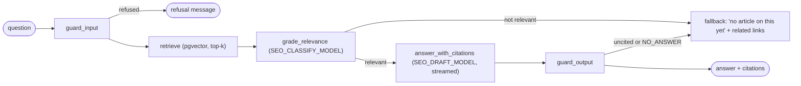

# Ask the Blog and retrieval (SEO v3, updated for v4)

A public assistant that answers **only from this site's articles**, with a citation for every statement, plus the
pgvector index the agents also use for related articles and internal links. It's **off by default**
(`ASK_BLOG_ENABLED=false`).

## Answer path (v4: a plain async pipeline)

v3 ran this as a LangGraph graph. In v4 it is a plain async pipeline (`app/services/ask_pipeline.py`), deliberately
**not a Crew or a Flow**: a multi-agent run per visitor question would be too slow and too expensive. The same pipeline
answers the public MCP tool `ask_blog` ([MCP.md](MCP.md)), with the same guards, cache and daily budget.

- **Grounding:** the answer prompt contains only the numbered excerpts, inside a `<data>` block. The model must cite
  `[n]` for every statement or reply `NO_ANSWER`. Citations are built from the excerpts the answer actually cites, as
  `/blog/slug#heading` links. The model never writes links itself. An answer that cites nothing is treated as unknown.
- **Input guards:** at most 500 characters; mostly Latin script (the site is in English); refusal for
  prompt-injection patterns ("ignore previous instructions", "system prompt", "you are now", `</data>`…), personal
  data (emails, phone numbers, keys) and obvious off-topic requests. Anything else off-topic fails the relevance
  grade and gets the fallback.
- **Retrieval input:** the question is embedded as asked (whitespace collapsed). The normalized form (lower-case,
  punctuation stripped) is used only for the cache key and the gap log, because `/`, `:`, `=` and quotes carry meaning
  in technical queries.
- **Score floor:** chunks below `ASK_BLOG_MIN_SCORE` (default 0.15) are dropped before grading. bge-small scores even
  unrelated text fairly high, so calibrate it from `seo_ask_log` (scores of answered vs fallback questions).
- **Grader and answer see the same excerpt text** (1,500 characters each), so a fact the grader never saw can't be
  the reason for a fallback.
- **Citations** are accepted as `[1]`, `[1][2]`, `[1, 2]` or `[1; 2]`.
- **Output guards:** links are stripped unless they point to this site or an allowlisted documentation domain.
- **Streaming:** server-sent events: `delta` events while the answer streams, then one `final` event with the guarded
  answer and citations, which replaces the streamed text in the widget. The start of the stream is held back until
  it's clear the answer isn't `NO_ANSWER`.

## Abuse and cost controls

| Control | Where | Default |
|---|---|---|
| Kill switch | web (`/api/ask` returns 404, no widget) and agent | `ASK_BLOG_ENABLED=false` |
| Same-origin JSON only | `/api/ask` | always |
| Per-IP limit | the existing Postgres limiter (`hit`), keyed on Envoy's `x-envoy-external-address`, otherwise the right-most `X-Forwarded-For` hop (the left-most is client-controlled) | 6/min, 60/day |
| Global limit | same limiter | 120/min |
| Daily cost cap, separate from the admin budget | agent budget guard (`purpose` `ask…`); never counts against `SEO_LLM_MONTHLY_BUDGET_USD` | `ASK_BLOG_DAILY_BUDGET_USD=1` |
| Answer cache | in-process, keyed on the normalised question + index version (any reindex changes the key) | 15 min |

Kong, the ingress and Istio routing are unchanged.

## Privacy

Questions are stored **without the IP address** (`seo_ask_log`). The web app may send a salted HMAC of the IP: the key
is derived from `BETTER_AUTH_SECRET` and the date, so it rotates daily and can't be recomputed without the secret. The
log is pruned after `ASK_BLOG_RETENTION_DAYS` (30). The widget says: "Answers come only from articles on this site.
Questions are stored without your IP address to improve the blog."

## Feedback into SEO

Fallback questions are upserted into `seo_ask_gaps` (normalised text, count, last seen). The weekly `drafts_weekly`
job clusters them with the same token-set clustering as Search Console queries. They appear in **Keyword
opportunities → Content gaps → "Asked on site"**, with their own source label, separate from GSC numbers. Questions
that look like they contain personal data are never shown. "Send to editorial calendar" creates an idea that the
crew can then draft.

## Chunking

The splitter in `services/seo-agent/app/embeddings.py` is fence-aware. It splits by h1–h3. Sections longer than
~1,800 characters are cut at paragraph boundaries that are **never inside a code block**, so code blocks stay whole.
Each chunk keeps its heading path (`Setup › Install`) and the anchor of its heading. Anchors follow
**rehype-slug / github-slugger**, as on the site, including `-1`/`-2` for repeated headings. A test compares the
anchors with the real github-slugger. The chunk hash covers the heading path and the text.

LangChain's `MarkdownHeaderTextSplitter` was tried first and dropped. It removes blank lines (so paragraph
boundaries are lost) and can't tell two sections with the same heading apart (D-45).

## Embeddings (`EMBEDDINGS_PROVIDER`)

| Provider | Model | Notes |
|---|---|---|
| `onnx` (default) | BAAI/bge-small-en-v1.5, ONNX, 384 dims | Baked into the image (pinned revision + sha256). ONNX Runtime on CPU, no torch. Query prefix per the model card, CLS pooling, L2 normalisation |
| `ollama` | `OLLAMA_EMBED_MODEL` (e.g. nomic-embed-text, 768) | Only if Ollama already runs in the cluster (`OLLAMA_URL`); NetworkPolicy egress must allow it |
| `api` | OpenAI-compatible `/embeddings` | Third party, off by default (`EMBEDDINGS_API_URL`, `EMBEDDINGS_API_KEY`) |
| `hash` | hashed bag of words | Tests and local development only |

Changing the provider changes the vector dimension. `ensure_schema` then recreates `seo_article_chunks` (derived
data only), and the next reindex rebuilds it.

## Index and reindexing

- **Table** `seo_article_chunks` (article_id → post, chunk_index, heading_path, anchor, content, content_hash,
  embedding `vector(N)`, model, updated_at), with an **HNSW** cosine index (IVFFlat on pgvector < 0.5). It's created
  by `seo-agent` at start-up when the `vector` extension exists, because its column type depends on the model.
- **Incremental:** a chunk is embedded again only when its `(content_hash, model)` changed. The stored hash covers the
  article title too (the title is part of the embedded text), so renaming an article re-embeds its chunks.
  Deploying this change re-embeds every chunk once (the stored hashes change format), so expect the first weekly run
  after it to take as long as a full reindex.
- **Safety:** a full or weekly reindex refuses to run (`IndexSafetyError`) when the web app returns no published
  articles, or (with 10 or more articles indexed) fewer than half of the indexed ones, instead of deleting the index.
  After checking the list, rerun `reindex_flow` with `{"force": true}`. Single-article reindexes (publish_flow) never
  run the guard. Chunks beyond the new count and chunks of articles that are no longer published are deleted.
- **When:** after every publish (publish_flow's `reindex` step, for that article), the weekly CronJob `seo-flow-reindex` (reindex_flow)
  (Sundays 03:17 UTC, `concurrencyPolicy: Forbid`, incremental), and on demand
  (`POST /api/admin/seo/agent/reindex {full}`, admin only, 6 per hour; a full reindex at most every 5 minutes).
- **Without pgvector**, retrieval reports unavailable. Ask the Blog returns the fallback, and the flows skip related
  articles. Nothing else breaks.
- **Direct SQL, not `langchain-postgres`:** its vector store owns its table layout, while this table needs the article
  foreign key, heading path, anchor and content hash (D-45).

## Operations

- Error rate alert: `AskBlogErrorRate`. First response: `ASK_BLOG_ENABLED=false` (the web
  ConfigMap/Secret plus the agent ConfigMap), then restart.
- Check retrieval quality after a model change: a full reindex, then ask the questions in the test fixture.
- Measured with the real model on 2026-11-10 (37 articles): "strict mTLS with Istio on minikube" → the Istio article
  (`#61-permissive-to-strict-without-guessing` among the top 3); "authenticate GitHub Actions to a minikube cluster"
  → the GitHub Actions article; "Valkey replace Redis" → the Valkey article.
