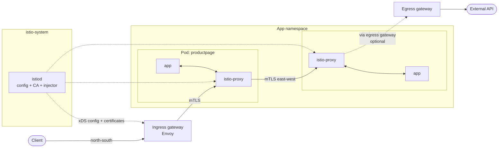

A service mesh moves the network plumbing (encryption, retries, timeouts, traffic splitting, telemetry) out of your application code and into a proxy that runs next to every workload. Istio is the most widely used open-source mesh, and Minikube is a cheap, safe place to learn it.

This guide is for DevOps and SRE engineers who know Kubernetes basics (Pods, Deployments, Services, Ingress) and are new to service mesh. It has two tracks:

- **The lab track.** A single-node Minikube cluster on a laptop with the Docker driver. Every command is copy-pasteable, and you can delete the cluster when you are done.
- **The "on my cluster" notes.** How Istio runs on `mk4`, the Minikube cluster that hosts this website, the MOKS SRE portal, RoboShop AI and my tooling. Those notes come from the repositories and from read-only `kubectl` and `istioctl` checks on 8 November 2026. Where `mk4` differs from the lab, I say so.

Version numbers that appear here (Istio 1.30.7, Kiali 2.34.0, Kubernetes v1.37.0) are what `mk4` runs, read from the cluster. They are not recommendations. Check the [supported releases page](https://istio.io/latest/docs/releases/supported-releases/) before you pick a version.

## 1. Introduction

### What a service mesh is

In a microservice system, most traffic is **east–west**: one service calling another inside the cluster. Kubernetes gives you service discovery and load balancing for that traffic, and stops there. It does not:

- encrypt traffic between pods,
- prove which workload is calling (identity),
- retry a failed call, time out a slow one, or stop calling a dead one,
- send 10% of traffic to a new version,
- tell you which service called which, how often, and how fast.

Teams used to solve this in each service, with HTTP client libraries, TLS certificates in config, and metrics middleware. That works until you have services in four languages, each with its own retry bugs.

A **service mesh** adds a dedicated infrastructure layer for service-to-service traffic. A proxy intercepts every request in and out of a workload and applies policy that you declare in one place. Your code makes a plain HTTP call; the mesh handles the rest.

### The problems it solves

| Problem | Without a mesh | With Istio |
| --- | --- | --- |
| Encryption in transit | TLS certificates managed per service | Automatic mutual TLS (mTLS) with rotating certificates |
| Who may call whom | NetworkPolicy (IP and port only) | AuthorizationPolicy on workload identity, path and method |
| Canary releases | Two Deployments and replica-count maths | Weighted routing: 90/10, 50/50, header-based |
| Flaky dependencies | Retry and timeout code in every client | Declarative timeouts, retries, circuit breakers |
| Visibility | Instrument every service | Request metrics, trace spans and a service graph from the proxy |

### Why Istio

Linkerd, Cilium service mesh and Consul are good alternatives. Istio stands out for:

- **Breadth.** Traffic management, security and observability in one project, with a large set of CRDs.
- **Envoy.** The data plane is Envoy, the same proxy used by many API gateways, so the skills transfer.
- **Two data plane modes.** Classic sidecars, or the newer sidecar-less **ambient** mode.
- **Ecosystem.** Kiali, Prometheus, Grafana and Jaeger integrate out of the box, and it is a CNCF graduated project.

The cost is complexity and resources. Istio has more moving parts than lighter meshes, and every sidecar uses memory. This guide covers both sides.

## 2. Architecture

Istio has a **control plane** that holds configuration and a **data plane** that carries traffic.

### Control plane: istiod

`istiod` is one binary (one Deployment) that:

- **Watches Kubernetes** for Services, Endpoints and Istio CRDs.
- **Translates** your VirtualServices, DestinationRules and policies into Envoy configuration.
- **Pushes** that configuration to every proxy over xDS (Envoy's discovery APIs: listeners, routes, clusters, endpoints).
- **Acts as a certificate authority.** It issues each workload a short-lived certificate for its identity, derived from its Kubernetes service account (a SPIFFE ID like `spiffe://cluster.local/ns/shop/sa/reviews`).
- **Runs the sidecar injection webhook**, which adds the proxy to new pods.

If istiod goes down, existing proxies keep working with their last configuration, but new pods cannot be injected or get certificates, and config changes stop flowing.

### Data plane: Envoy sidecars

In **sidecar mode**, every meshed pod gets an extra container, `istio-proxy` (Envoy plus a small agent, `pilot-agent`). Traffic redirection rules (iptables, set up by an `istio-init` init container or by the `istio-cni` node agent) send all inbound and outbound pod traffic through Envoy. The application talks plain HTTP to `localhost`-level networking; Envoy upgrades it to mTLS on the wire.

### Gateways

- **Ingress gateway.** A standalone Envoy Deployment at the edge of the mesh for **north–south** traffic coming in. You configure it with a `Gateway` resource (ports, hosts, TLS) and bind routes with a `VirtualService`.
- **Egress gateway.** A standalone Envoy for traffic leaving the mesh, useful when all outbound calls must leave through one place for auditing or firewall rules.

Istio also supports the Kubernetes Gateway API (`gateway.networking.k8s.io`) as an alternative to its own `Gateway` and `VirtualService` resources. This guide uses the classic Istio APIs because most existing docs and examples still do.

### Diagram



Solid lines are request traffic. Dotted lines from istiod are configuration and certificates, not requests.

### Sidecar mode vs ambient mode

**Ambient mode** removes the per-pod sidecar. It splits the data plane into two layers:

- **ztunnel** ("zero-trust tunnel"): a per-node DaemonSet that handles Layer 4. It gives every pod mTLS, identity and L4 authorization, and tunnels traffic between nodes using a protocol called HBONE.
- **Waypoint proxies**: optional Envoy Deployments, usually one per namespace or service account, that you add only where you need Layer 7 features (HTTP routing, retries, header-based policy).

| | Sidecar mode | Ambient mode |
| --- | --- | --- |
| Proxy placement | One Envoy per pod | One ztunnel per node, plus optional waypoints |
| Joining the mesh | Label namespace, **restart pods** | Label namespace, no restart |
| L4 mTLS and identity | Yes | Yes (ztunnel) |
| L7 routing, retries, L7 policy | Always available | Only through a waypoint |
| Memory overhead | Grows with pod count | Grows with node count, plus waypoints |
| Maturity of docs and examples | Most material assumes sidecars | Newer; check feature status per feature |
| Jobs and init-container quirks | Need care (see section 6) | Mostly gone, no sidecar in the pod |

Recommendation: learn with sidecars first, because the request path is easier to see and nearly every tutorial uses it. Evaluate ambient when sidecar memory or restart churn starts to hurt. `mk4` runs sidecar mode.

## 3. Key features

Istio's features map to CRDs. Knowing which CRD owns which behaviour is half of troubleshooting.

| Group | Feature | What it does | CRD |
| --- | --- | --- | --- |
| Traffic management | Request routing | Route by host, path, header, method | `VirtualService` |
| | Canary / traffic shifting | Split traffic by weight between subsets | `VirtualService` + `DestinationRule` (subsets) |
| | Mirroring | Copy live traffic to another version, discard its responses | `VirtualService` (`mirror`) |
| | Gateways | Expose services at the mesh edge | `Gateway` (or Gateway API `Gateway` + `HTTPRoute`) |
| | External services | Add outside hosts to the mesh registry | `ServiceEntry` |
| | Proxy scope | Limit what config each sidecar receives | `Sidecar` |
| Security | Automatic mTLS | Encrypt and authenticate pod-to-pod traffic | `PeerAuthentication` |
| | Authorization | Allow or deny by identity, namespace, path, method | `AuthorizationPolicy` |
| | JWT authentication | Validate end-user tokens | `RequestAuthentication` (+ `AuthorizationPolicy` to require them) |
| Observability | Metrics | Request count, duration, size per source and destination | Built in; tune with `Telemetry` |
| | Tracing | Envoy creates spans; apps must forward trace headers | `Telemetry` (+ mesh config) |
| | Access logs | Per-request log lines from Envoy | `Telemetry` |
| | Service graph | Live topology and health | Kiali (reads Prometheus) |
| Resilience | Timeouts | Fail a slow request after N seconds | `VirtualService` (`timeout`) |
| | Retries | Retry on chosen failures | `VirtualService` (`retries`) |
| | Circuit breaking | Cap connections and pending requests; eject bad hosts | `DestinationRule` (`connectionPool`, `outlierDetection`) |
| | Fault injection | Inject delays or errors to test resilience | `VirtualService` (`fault`) |

### Example: a 90/10 canary with timeout and retries

This sends 90% of traffic for `reviews` to `v1` and 10% to `v2`. Each request has a 3-second overall budget, and Envoy retries up to twice on connection failures and gateway errors. The `DestinationRule` defines the subsets by pod label and adds a basic circuit breaker.

```yaml
apiVersion: networking.istio.io/v1
kind: DestinationRule
metadata:
  name: reviews
  namespace: bookinfo
spec:
  host: reviews                      # the Kubernetes Service name
  trafficPolicy:
    connectionPool:
      tcp:
        maxConnections: 100
      http:
        http1MaxPendingRequests: 50
    outlierDetection:                # eject a pod after 5 consecutive 5xx
      consecutive5xxErrors: 5
      interval: 10s
      baseEjectionTime: 30s
      maxEjectionPercent: 50
  subsets:
    - name: v1
      labels:
        version: v1                  # must match the pod labels exactly
    - name: v2
      labels:
        version: v2
---
apiVersion: networking.istio.io/v1
kind: VirtualService
metadata:
  name: reviews
  namespace: bookinfo
spec:
  hosts:
    - reviews
  http:
    - route:
        - destination:
            host: reviews
            subset: v1
          weight: 90
        - destination:
            host: reviews
            subset: v2
          weight: 10
      timeout: 3s                    # total budget, including retries
      retries:
        attempts: 2
        perTryTimeout: 1s
        retryOn: connect-failure,refused-stream,gateway-error
```

To promote the canary, change the weights (50/50, then 0/100) and commit. Two rules of thumb:

- Keep `attempts × perTryTimeout` inside `timeout`, or the last retries never run.
- Retry only failures that are safe to repeat. `gateway-error` covers 502, 503 and 504; avoid retrying every `5xx` on endpoints that change data.

## 4. Implementation on Minikube

### 4.1 Start Minikube

The Docker driver works on macOS, Linux and Windows. Istio's Minikube platform page suggests about 16 GB of memory and 4 CPUs for the demo profile with add-ons. In practice 8 GB is enough for Istio plus Bookinfo if you skip some add-ons; these are approximate, so watch `kubectl top` and adjust.

```bash
minikube start \
  --profile istio-lab \
  --driver=docker \
  --cpus=4 \
  --memory=12g \
  --disk-size=40g

kubectl config use-context istio-lab
kubectl get nodes
```

If Docker Desktop has a lower memory limit than `--memory`, Minikube fails at start. Raise the limit in Docker Desktop's settings first.

### 4.2 Install istioctl and run the precheck

```bash
# Downloads the latest release into ./istio-<version>.
# To pin one: curl -L https://istio.io/downloadIstio | ISTIO_VERSION=<version> sh -
curl -L https://istio.io/downloadIstio | sh -
cd istio-*/
export PATH="$PWD/bin:$PATH"

istioctl version           # client version; no control plane yet
istioctl x precheck        # checks Kubernetes version, permissions, existing installs
```

`precheck` should end with "No issues found when checking the cluster. Istio is safe to install or upgrade!" Fix anything it reports before installing.

Keep `istioctl` on the same minor version as the control plane. On my Mac, the Homebrew `istioctl` was 1.20.2 while `mk4` runs 1.30.7. It still printed proxy status, but analyzers and `proxy-config` output from a client that far behind can mislead. Use the binary from the matching release download.

### 4.3 Install Istio with the demo profile

```bash
istioctl install --set profile=demo -y
kubectl get pods -n istio-system
```

The `demo` profile installs istiod, an ingress gateway and an egress gateway, with higher trace sampling and access logs on. It is meant for learning, not production. The `default` profile (istiod plus ingress gateway) is the usual starting point for real clusters, and `minimal` installs istiod only.

**With Helm, for Argo CD.** In a GitOps setup you want Istio as charts that Argo CD (or Terraform) can reconcile, not an imperative `istioctl install`. The charts are `base` (CRDs), `istiod`, optional `cni`, and `gateway`:

```bash
helm repo add istio https://istio-release.storage.googleapis.com/charts
helm repo update

helm install istio-base istio/base -n istio-system --create-namespace --wait
helm install istiod istio/istiod -n istio-system --wait
helm install istio-ingress istio/gateway -n istio-ingress --create-namespace --wait
```

In Argo CD, make each chart an `Application` and order them with sync waves: `base` first, then `istiod`, then gateways. Pin the chart `targetRevision` to an exact version so an upgrade is a reviewed Git change.

> **On my cluster.** Istio on `mk4` is installed from these Helm charts, but through Terraform `helm_release` resources in my `miniKube` repository (`istio.tf`), not through Argo CD: `base`, `cni` and `istiod`, all pinned to 1.30.7. Argo CD still owns the application side (each app's mesh policies). I moved the add-ons from Argo CD to Terraform so the platform layer is installed before Argo CD and the apps it syncs. There is **no Istio ingress gateway**, because another proxy is the edge (section 4.6).
>
> Three istiod settings matter on `mk4`, and all are worth copying:
>
> - `pilot.cni.enabled: true` with the `cni` chart. Without the CNI agent, each injected pod needs an `istio-init` container with `NET_ADMIN` and `NET_RAW`, and the Pod Security `baseline` level on the `moks` namespace rejected every injected pod. A server-side dry run (`kubectl apply --dry-run=server`) showed this before any rollout broke.
> - `ENABLE_NATIVE_SIDECARS: "true"` and `holdApplicationUntilProxyStarts: true`. The proxy starts before the app and stops after it, which fixes the startup race and the Job problem in section 6.
> - `meshConfig.defaultHttpRetryPolicy.attempts: 0`. Istio retries some failures by default. On a shop with checkout and payment calls, a silent mesh retry could replay a payment, so retries are off by default and added per route where safe.

### 4.4 Enable sidecar injection

Injection happens when a pod is **created**. Labelling a namespace does nothing to pods that already run.

```bash
kubectl create namespace bookinfo
kubectl label namespace bookinfo istio-injection=enabled

# For an existing namespace, label it and restart its workloads:
kubectl label namespace my-app istio-injection=enabled --overwrite
kubectl rollout restart deployment -n my-app
kubectl rollout restart statefulset -n my-app   # if any; see the warning below

# Check: READY should show 2/2 (app + istio-proxy)
kubectl get pods -n my-app
```

To skip one workload in an injected namespace, set the pod label `sidecar.istio.io/inject: "false"` in its pod template.

Warning for Minikube and other `hostPath`-backed clusters: restarting a StatefulSet can reschedule a pod onto another node. On a multi-node Minikube with the default `standard` storage class, the volume does not follow it, and the pod comes up with an empty disk. On a single-node lab this cannot happen. On `mk4` (8 nodes) I check where each database pod will land before a restart.

### 4.5 Deploy Bookinfo and expose it through the gateway

Bookinfo is Istio's sample app: `productpage` calls `details` and `reviews`, and `reviews` has three versions (v3 calls `ratings`). The files ship in the release directory you downloaded.

```bash
kubectl apply -n bookinfo -f samples/bookinfo/platform/kube/bookinfo.yaml
kubectl get pods -n bookinfo          # wait for every pod to be 2/2 Running

# Smoke test from inside the mesh
kubectl exec -n bookinfo deploy/ratings-v1 -c ratings -- \
  curl -sS productpage:9080/productpage | grep -o "<title>.*</title>"

# Gateway + VirtualService for the ingress gateway, and subsets for every service
kubectl apply -n bookinfo -f samples/bookinfo/networking/bookinfo-gateway.yaml
kubectl apply -n bookinfo -f samples/bookinfo/networking/destination-rule-all.yaml
istioctl analyze -n bookinfo
```

The ingress gateway Service has `type: LoadBalancer`. Minikube has no cloud load balancer, so `EXTERNAL-IP` stays `<pending>` until you run a tunnel:

```bash
# Terminal 1: leave it running (may ask for sudo to add routes)
minikube tunnel --profile istio-lab

# Terminal 2
kubectl get svc istio-ingressgateway -n istio-system
export INGRESS_HOST=$(kubectl -n istio-system get svc istio-ingressgateway \
  -o jsonpath='{.status.loadBalancer.ingress[0].ip}')
export GATEWAY_URL="$INGRESS_HOST:80"
curl -sS "http://$GATEWAY_URL/productpage" | grep -o "<title>.*</title>"
```

On macOS with the Docker driver the tunnel IP is often `127.0.0.1`. If the tunnel is awkward, port-forward instead; this is the most reliable option on a laptop:

```bash
kubectl port-forward -n istio-system svc/istio-ingressgateway 8080:80
curl -sS http://localhost:8080/productpage | grep -o "<title>.*</title>"
```

Now try the canary from section 3. Apply the YAML (the subsets already exist from `destination-rule-all.yaml`, so you can apply only the VirtualService), then refresh the page about 20 times: about 2 in 20 should show black stars (`v2`).

### 4.6 How Kong and Istio coexist

A common split, and the one I use: an **edge proxy handles north–south**, and **Istio handles east–west**. The edge proxy terminates public TLS, does host and path routing, and applies rate limits and authentication plugins. Istio encrypts and observes the calls between services behind it. In that design you do not need Istio's ingress gateway.

The design decision is whether the edge proxy is **in the mesh** (has a sidecar) or **outside** it.

| | Edge proxy outside the mesh | Edge proxy in the mesh |
| --- | --- | --- |
| Setup | Nothing to change | Inject a sidecar into the edge proxy's namespace |
| Edge → app traffic | Plain text | mTLS, if routing is done right (below) |
| App namespaces can use STRICT mTLS | No, edge traffic would be rejected; edge ports must stay PERMISSIVE | Yes |
| Kiali shows edge → app edges | No, source shows as unknown | Yes |
| Istio routing (canary, retries) applies to edge traffic | No | Yes |

To get real mTLS from an in-mesh edge proxy, two things must be true:

1. **Inbound to the edge proxy must bypass its sidecar.** The public port should not depend on Envoy, and if the edge receives the PROXY protocol from a load balancer, Envoy would break it. Exclude inbound ports with the pod annotation `traffic.sidecar.istio.io/includeInboundPorts: ""` (or `excludeInboundPorts`).
2. **Outbound from the edge proxy must target the Service, with the Service's host name.** Envoy picks a route by destination and `Host` header. Many ingress controllers send requests straight to **pod IPs** (their own load balancing) and keep the public `Host` header (for example `jithendar.com`). Envoy does not recognise that combination as a mesh service, so it forwards the traffic as raw TCP to `PassthroughCluster`: plain text, no mesh policy. For Kong, point each Kong Service at the Kubernetes Service DNS name (`web.my-app.svc.cluster.local`) and leave `preserve_host` off, or have Kong set the upstream `Host` to that name. With Kong's Ingress Controller, the Service annotation `ingress.kubernetes.io/service-upstream: "true"` makes Kong send to the Service instead of pod IPs.

**PERMISSIVE → STRICT migration.** Istio starts in PERMISSIVE mode: sidecars accept both mTLS and plain text. Move to STRICT in steps:

```bash
# 1. Inject every client and server in the namespace; check all pods are 2/2.
kubectl get pods -n my-app

# 2. Check that traffic is already mTLS. In Prometheus:
#    sum by (source_workload, connection_security_policy) (
#      rate(istio_requests_total{destination_workload_namespace="my-app"}[5m]))
#    Every row should show connection_security_policy="mutual_tls", none "none".

# 3. Lock the namespace.
kubectl apply -f - <<'EOF'
apiVersion: security.istio.io/v1
kind: PeerAuthentication
metadata:
  name: default
  namespace: my-app
spec:
  mtls:
    mode: STRICT
EOF
```

Keep port-level exceptions for clients that are not in the mesh, such as a Prometheus that scrapes pod IPs directly:

```yaml
apiVersion: security.istio.io/v1
kind: PeerAuthentication
metadata:
  name: web-metrics
  namespace: my-app
spec:
  selector:
    matchLabels:
      app: web
  mtls:
    mode: STRICT
  portLevelMtls:
    "9464":                 # the app's metrics port stays reachable in plain text
      mode: PERMISSIVE
```

A mesh-wide policy (a `PeerAuthentication` named `default` in `istio-system`) is the last step, after every namespace is clean.

> **On my cluster.** The live edge on `mk4` today is **Traefik**, not Kong. Kong Gateway is being prepared as its replacement for `jithendar.com`, `moks`, `tools` and `roboshop-ai`, on a branch that is not deployed yet. The same decisions apply to both, and these are the ones I made with Traefik:
>
> - Traefik **is** in the mesh: its namespace is labelled `istio-injection=enabled`, and inbound ports bypass the sidecar with `includeInboundPorts: ""`, because the host's HAProxy sends the PROXY protocol to Traefik.
> - Traefik still sends to **pod IPs with `Host: jithendar.com`**, so its outbound calls go through `PassthroughCluster` in plain text. Kiali shows the apps' callers as unknown. Fixing that needs Service-based upstreams and a per-route `Host` rewrite, which breaks apps that read the `Host` header. That fix is on the list for the Kong cut-over.
> - So `moks` runs a STRICT `PeerAuthentication` with the ports Traefik and Prometheus use kept PERMISSIVE, and `jithendar` and `roboshop-ai` are meshed but not yet STRICT. A STRICT policy in `roboshop-ai` today would reject every `/roboshop` request from the edge.

### 4.7 Install the observability add-ons

The release download includes quick-start manifests for Prometheus, Grafana, Jaeger and Kiali. They are for demos (no persistence, no authentication).

```bash
kubectl apply -f samples/addons/prometheus.yaml
kubectl apply -f samples/addons/grafana.yaml
kubectl apply -f samples/addons/jaeger.yaml
kubectl apply -f samples/addons/kiali.yaml
kubectl rollout status deployment/kiali -n istio-system

# Generate traffic, then open the dashboards (each command port-forwards)
for i in $(seq 1 200); do curl -s -o /dev/null "http://$GATEWAY_URL/productpage"; done
istioctl dashboard kiali      # service graph: Graph > namespace bookinfo
istioctl dashboard grafana    # Istio Mesh / Service / Workload dashboards
istioctl dashboard jaeger     # traces, service productpage.bookinfo
```

Tracing only links spans into one trace if the application **forwards the trace headers** (`traceparent`, or the `x-b3-*` set) from the incoming request to its outgoing calls. Envoy can create spans, but it cannot see how your code connects an inbound request to its outbound calls. Bookinfo forwards them; your apps may not.

> **On my cluster.** `mk4` does not use the sample add-ons. Prometheus, Grafana, Jaeger and Kiali are Terraform-managed Helm releases with persistent storage. Prometheus has two extra scrape jobs, one for istiod and one for Envoy's stats port (15090) on every sidecar. Kiali 2.34.0 runs in view-only mode behind token authentication. Prometheus itself has an injected sidecar but `includeOutboundIPRanges: ""`, so its scrapes bypass Envoy and do not need mTLS.

### 4.8 Rough resource usage

Measure your own cluster: `kubectl top pods -A --containers | grep istio-proxy`. The `mk4` figures below are a single `kubectl top` reading on 8 November 2026 with light traffic, so treat them as rough. Request and limit values are what I configured, not Istio defaults.

| Component | Count on `mk4` | Measured (approx.) | Requests / limits I set |
| --- | --- | --- | --- |
| istiod | 1 | 5m CPU, 184 MiB | 100m, 256 MiB / 1 GiB limit |
| istio-cni node agent | 8 (one per node) | ~1m CPU, 24–33 MiB each | chart defaults |
| istio-proxy sidecar | 54 | ~44 MiB average, 61 MiB largest, ~2.3 GiB total; 255m CPU total | 20m, 64 MiB / 256 MiB limit |
| Kiali | 1 | 2m CPU, 79 MiB | chart defaults |

What this means on a laptop:

- **Sidecars are the real cost.** Each meshed pod adds roughly 40–60 MiB here. On a busy service with many endpoints and routes it will be more, because Envoy's memory grows with the configuration it holds (see `Sidecar` scoping in section 7).
- **The demo profile adds two gateways and the sample add-ons.** I have not measured those on a laptop, so I won't quote numbers; check with `kubectl top` after install. Prometheus is usually the largest of the add-ons.
- **Pending pods are the first symptom of not enough memory** (section 6).

## 5. Basic troubleshooting

Work **outside-in**: confirm the control plane, then the configuration, then the proxy's view of it, then the live request. Most problems show up by step 3.

**1. Is the control plane healthy?**

```bash
kubectl get pods -n istio-system
kubectl get mutatingwebhookconfiguration | grep -i istio
```

istiod must be `Running` and ready. If it is not, nothing else here is meaningful.

**2. Is the configuration valid?**

```bash
istioctl analyze -n my-app          # one namespace
istioctl analyze -A                 # every namespace
```

`analyze` catches the common mistakes: subsets that match no pods, VirtualServices pointing at missing hosts, missing sidecars, badly named ports. On `mk4` it reports, among others:

```text
Warning [IST0103] (Pod roboshop-ai/ecr-refresh-29901960-ftw69) The pod ... is missing the Istio proxy.
Info [IST0118] (Service roboshop-ai/cart-service) Port name p4107 (port: 4107, targetPort: 4107) doesn't follow the naming convention of Istio port.
```

Both are real to-dos: a CronJob pod created before injection, and ports named `p4107` instead of `http-cart` (section 6 explains why that matters).

**3. Have the proxies received the configuration?**

```bash
istioctl proxy-status
```

Each proxy shows CDS, LDS, EDS and RDS (clusters, listeners, endpoints, routes) as `SYNCED`. `STALE` means istiod sent configuration that the proxy did not acknowledge: check istiod logs and the proxy's connection to istiod (step 9). A pod missing from the list has no sidecar or cannot reach istiod. On `mk4` all 54 proxies report `SYNCED` on 1.30.7.

**4. What does this proxy actually have?**

```bash
POD=$(kubectl get pod -n bookinfo -l app=productpage -o jsonpath='{.items[0].metadata.name}')

istioctl proxy-config listeners "$POD" -n bookinfo                  # ports Envoy listens on
istioctl proxy-config routes    "$POD" -n bookinfo --name 9080      # HTTP routes for port 9080
istioctl proxy-config clusters  "$POD" -n bookinfo --fqdn reviews.bookinfo.svc.cluster.local
istioctl proxy-config endpoints "$POD" -n bookinfo --cluster "outbound|9080|v2|reviews.bookinfo.svc.cluster.local"
```

Read them in order. No route for the host means the VirtualService did not apply. A cluster with no endpoints (or endpoints not `HEALTHY`) means the subset labels match no pods, or the pods are not ready. Add `-o json` for full detail.

**5. Which policies apply to this pod?**

```bash
istioctl x describe pod "$POD" -n bookinfo
```

This summarises the Services, VirtualServices, DestinationRules and mTLS mode that affect the pod, and warns about mismatches. It is the fastest single command for "why is this pod not doing what I configured?"

**6. What do the proxy logs say?**

```bash
kubectl logs "$POD" -n bookinfo -c istio-proxy --tail=100
```

Look for certificate errors, `warming` messages and rejected configuration.

**7. Turn on access logs.** The demo profile has them on. Otherwise, enable them mesh-wide with the Telemetry API:

```yaml
apiVersion: telemetry.istio.io/v1
kind: Telemetry
metadata:
  name: mesh-default
  namespace: istio-system      # root namespace = whole mesh
spec:
  accessLogging:
    - providers:
        - name: envoy
```

Each request then logs one line in the `istio-proxy` container, with the status code, the **response flags** (table below), the upstream cluster and the timing. The response flag usually tells you which side failed.

**8. Raise the proxy log level, briefly.**

```bash
istioctl proxy-config log "$POD" -n bookinfo --level debug
# reproduce the problem, read the logs, then:
istioctl proxy-config log "$POD" -n bookinfo --level warning
```

Debug logging is very noisy. Scope it if you can (for example `--level connection:debug,http:debug`) and turn it off afterwards.

**9. Check istiod logs.**

```bash
kubectl logs -n istio-system deploy/istiod --tail=200
```

Look for rejected configuration, push errors, and certificate signing failures. If a proxy is missing from `proxy-status`, also check that the pod can reach `istiod.istio-system.svc:15012`: a NetworkPolicy that blocks it, or blocks DNS, stops the proxy from ever becoming ready.

### Envoy response flags

| Flag | Meaning | Usual cause |
| --- | --- | --- |
| `NR` | No route configured | No VirtualService or route matches the host or path; at a gateway, the `Gateway` host does not match or the VirtualService is not bound to the gateway |
| `UH` | No healthy upstream | Cluster has zero healthy endpoints: subset labels match no pods, pods not ready, or all ejected by outlier detection |
| `UF` | Upstream connection failure | Could not connect: mTLS mismatch (plain text to STRICT, or `ISTIO_MUTUAL` to a pod without a sidecar), app not listening, NetworkPolicy |
| `URX` | Upstream retry limit exceeded | Every retry attempt failed; look at why the first attempt failed |
| `UO` | Upstream overflow | Circuit breaker tripped: `connectionPool` limits reached |
| `UT` | Upstream request timeout | Route `timeout` or `perTryTimeout` hit; upstream too slow |
| `DC` | Downstream connection termination | The client closed the connection first, often a client timeout shorter than the server's |

## 6. Common issues and fixes

| Symptom | Cause | Fix |
| --- | --- | --- |
| Pod shows `1/1`, no `istio-proxy` container | Namespace not labelled, pod created before the label, or `sidecar.istio.io/inject: "false"` | `kubectl get ns -L istio-injection`; label it; `kubectl rollout restart`; check the pod template labels |
| Injected pods rejected at creation (`violates PodSecurity`) | `istio-init` needs `NET_ADMIN`/`NET_RAW`, which Pod Security `baseline` forbids | Install the `istio-cni` chart and set `pilot.cni.enabled: true` (`mk4` hit this) |
| Pods `Pending` or `OOMKilled` on Minikube | Not enough node memory for istiod, gateways, add-ons and one sidecar per pod | Start Minikube with more memory; skip unused add-ons; set sidecar requests/limits (`global.proxy.resources`); scope config with `Sidecar` |
| Ingress gateway `EXTERNAL-IP` stuck `<pending>` | Minikube has no cloud load balancer | Run `minikube tunnel`, or `kubectl port-forward svc/istio-ingressgateway` |
| `404` from the gateway (`NR` in access log) | Gateway `hosts` does not match the request `Host`, VirtualService not bound with `gateways:`, or wrong namespace | Match hosts exactly, add `gateways: [bookinfo-gateway]`, run `istioctl analyze` |
| `503`, flag `UF`, after enabling mTLS | One side expects mTLS, the other sends plain text (client without sidecar to a STRICT server, or a DestinationRule with `ISTIO_MUTUAL` to a pod without sidecar) | `istioctl x describe pod`; inject the client, or use PERMISSIVE / port-level exception |
| `503`, flag `UH` or `NR`, after adding a DestinationRule | Subset labels (`version: v2`) do not exist on any pod, or the VirtualService names a subset that is not defined | Compare `kubectl get pods --show-labels` with the subsets; apply DestinationRules before VirtualServices that use them |
| App crashes at start with "connection refused" to a DB or API | App started before Envoy was ready, so its first outbound calls failed | `holdApplicationUntilProxyStarts: true` (mesh-wide or per pod via `proxy.istio.io/config`), or native sidecars |
| Job or CronJob pod never completes | The main container exits but `istio-proxy` keeps running | Enable native sidecars (`ENABLE_NATIVE_SIDECARS`, Kubernetes sidecar containers), or have the job call `curl -X POST localhost:15020/quitquitquit` at the end, or skip injection for the job |
| Calls to an external API fail (`502`/`503`, or connection reset) | `outboundTrafficPolicy` is `REGISTRY_ONLY`, so unknown hosts are blocked | Add a `ServiceEntry` for the host (and a DestinationRule with `tls.mode: SIMPLE` if Envoy originates TLS) |
| HTTP features ignored, odd resets, or gRPC breaks | Protocol detection guessed wrong because the Service port name or `appProtocol` is missing | Name ports `http-…`, `grpc-…`, `tcp-…`, or set `appProtocol`; `istioctl analyze` flags `IST0118` |
| `403 RBAC: access denied` | An `AuthorizationPolicy` denies the request, or any `ALLOW` policy exists and none matches | Check policies in the namespace and root namespace; check the caller's identity (service account) with `istioctl x describe pod` |
| Liveness/readiness probes fail after injection | Probe rewriting disabled (`sidecar.istio.io/rewriteAppHTTPProbers: "false"`), or a NetworkPolicy blocks kubelet → 15020 | Leave probe rewriting on (the default) so probes go through pilot-agent on 15020; allow the port |
| Config changes have no effect | Applied to the wrong namespace, failed validation, or proxy `STALE` / disconnected | `istioctl proxy-status`; `istioctl proxy-config routes`; istiod logs; check NetworkPolicy allows DNS and `istiod:15012` |
| Latency spike, upstream overloaded during an incident | Retry storm: each layer retries, multiplying traffic | Retries in one layer only; small `attempts`; `perTryTimeout`; circuit breakers; set the mesh default retries to 0 where calls are not idempotent |
| Kiali graph empty or shows `unknown` | No traffic in the time window, Prometheus not scraping Envoy, pods without sidecars, missing `app`/`version` labels, or an edge proxy sending pass-through TCP | Generate traffic; check Prometheus targets; label workloads; see section 4.6 for edge proxies |

### A real outage: the sidecar that could not find istiod

On 8 November 2026, after I enabled sidecars in the `jithendar` namespace, this site returned `503`. The chain was:

1. Postgres and Redis already had NetworkPolicies with no DNS egress (they never needed DNS).
2. I added a NetworkPolicy for the sidecars that allowed egress to istiod on 15012, but not DNS.
3. The sidecars could not resolve `istiod.istio-system.svc`, so they never became ready.
4. With `holdApplicationUntilProxyStarts`, Postgres never started, and the web app failed at startup waiting for its database lock.

`istioctl proxy-status` showed the database pods missing, and the `istio-proxy` logs showed DNS timeouts. The fix was a DNS egress rule (UDP and TCP 53 to `kube-dns`) in the sidecar NetworkPolicy. Lesson: if your cluster enforces NetworkPolicy, every meshed pod needs DNS and `istiod:15012` egress, and the monitoring namespace needs ingress to 15020 and 15090. Test with a server-side dry run and one pod before restarting a namespace.

## 7. Best practices and conclusion

**Adopt gradually.** Start with one non-critical namespace. Inject, leave mTLS PERMISSIVE, and watch Kiali and Grafana for a week. Then STRICT for that namespace. Then the next namespace. Add L7 features (canaries, retries) only once the basics are boring.

**GitOps everything, and lint it in CI.** Keep Istio's charts (pinned versions) and every VirtualService, DestinationRule and policy in Git, synced by Argo CD. Run `istioctl analyze` on the manifests before merge, offline:

```bash
istioctl analyze --use-kube=false -R ./deploy/
```

Exit code non-zero on errors fails the pipeline. Keep high-blast-radius objects, like a namespace's STRICT `PeerAuthentication`, behind a human apply step: on `mk4` CI deliberately skips them.

**Label every workload `app` and `version`.** Kiali, Istio metrics and subsets all rely on them.

**Name Service ports by protocol.** `http-web`, `grpc-api`, `tcp-postgres`, or set `appProtocol`. Auto-detection is a guess; a name is a fact.

**Set sidecar resources.** Set requests and a memory limit mesh-wide (`global.proxy.resources`) and override per pod with `sidecar.istio.io/proxyCPU` / `sidecar.istio.io/proxyMemory` annotations where needed.

**Scope configuration with `Sidecar`.** By default every proxy gets configuration for every service in the mesh. A namespace-level `Sidecar` cuts memory and push time:

```yaml
apiVersion: networking.istio.io/v1
kind: Sidecar
metadata:
  name: default
  namespace: bookinfo
spec:
  egress:
    - hosts:
        - "./*"              # services in this namespace
        - "istio-system/*"   # the control plane and gateways
```

**Upgrade with revisions.** Instead of upgrading istiod in place, install the new version side by side with a revision name, move namespaces one at a time, then remove the old one:

```bash
helm install istiod-<new> istio/istiod -n istio-system \
  --version <new-version> --set revision=<new>      # e.g. revision=1-31-0 (no dots)

kubectl label namespace bookinfo istio-injection- istio.io/rev=<new> --overwrite
kubectl rollout restart deployment -n bookinfo
istioctl proxy-status                                # bookinfo now on the new version
```

Revision tags (`istioctl tag set prod-stable --revision <new>`) let namespaces point at a stable name, so moving the whole mesh is one tag change. Read the upgrade notes for every minor version you cross.

**Back up Istio configuration with Velero.** Your Istio objects are in Git, but a Velero backup gives you a point-in-time restore of the live state, including objects someone applied by hand:

```bash
velero backup create istio-config \
  --include-resources 'virtualservices.networking.istio.io,destinationrules.networking.istio.io,gateways.networking.istio.io,serviceentries.networking.istio.io,sidecars.networking.istio.io,peerauthentications.security.istio.io,authorizationpolicies.security.istio.io,requestauthentications.security.istio.io,telemetries.telemetry.istio.io'

# Also the mesh root CA, so restored workloads keep trusting each other
velero backup create istio-ca --include-namespaces istio-system \
  --include-resources secrets
```

If the root CA secret (`istio-ca-secret`, or `cacerts` if you plugged in your own CA) is lost, istiod creates a new root and every workload must restart to get certificates from it. Treat that secret like any other key material. On `mk4`, the `velero` namespace and CRDs exist but the Velero server is not installed yet, so this is the plan, not something running today.

### Conclusion

Istio gives you mTLS, fine-grained authorization, traffic shifting, resilience and a live service graph without changing application code. The price is more pods, more memory and a new layer to debug. Minikube is the right place to pay the learning part of that price: install the demo profile, break Bookinfo on purpose with fault injection and bad subsets, and practise the outside-in checklist until `istioctl proxy-config` feels normal.

On a real cluster, the hard parts were never the YAML in the docs. They were the edges: the edge proxy and the mesh, Pod Security and `istio-init`, NetworkPolicies and DNS, and stateful pods that move when restarted. Plan for those, adopt one namespace at a time, and keep every change in Git.

## Sources

- [What is Istio?](https://istio.io/latest/docs/overview/what-is-istio/)
- [Architecture](https://istio.io/latest/docs/ops/deployment/architecture/)
- [Sidecar or ambient?](https://istio.io/latest/docs/overview/dataplane-modes/)
- [Minikube platform setup](https://istio.io/latest/docs/setup/platform-setup/minikube/)
- [Install with istioctl](https://istio.io/latest/docs/setup/install/istioctl/)
- [Install with Helm](https://istio.io/latest/docs/setup/install/helm/)
- [Bookinfo application](https://istio.io/latest/docs/examples/bookinfo/)
- [Traffic management concepts](https://istio.io/latest/docs/concepts/traffic-management/)
- [Security concepts](https://istio.io/latest/docs/concepts/security/)
- [Mutual TLS migration](https://istio.io/latest/docs/tasks/security/authentication/mtls-migration/)
- [Observability integrations](https://istio.io/latest/docs/ops/integrations/)
- [Diagnostic tools](https://istio.io/latest/docs/ops/diagnostic-tools/)
- [Common problems](https://istio.io/latest/docs/ops/common-problems/)
- [Protocol selection](https://istio.io/latest/docs/ops/configuration/traffic-management/protocol-selection/)
- [Application requirements](https://istio.io/latest/docs/ops/deployment/application-requirements/)
- [Canary upgrades](https://istio.io/latest/docs/setup/upgrade/canary/)
- [Best practices](https://istio.io/latest/docs/ops/best-practices/)
- [Supported releases](https://istio.io/latest/docs/releases/supported-releases/)
- [Envoy access log format and response flags](https://www.envoyproxy.io/docs/envoy/latest/configuration/observability/access_log/usage)
