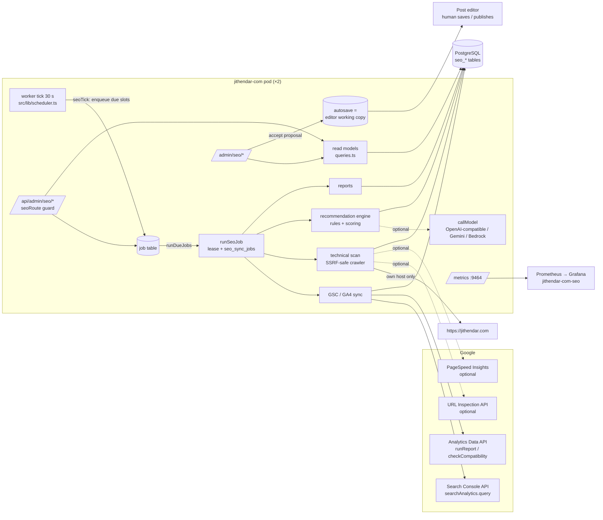
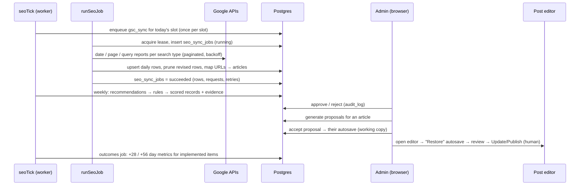

# SEO intelligence platform: architecture, schema, API, configuration

Admin-only (`/admin/seo`, role `admin`). Reads Google Search Console (GSC) and GA4, turns the data into
evidence-backed recommendations, and feeds the CMS editor. **It never publishes or edits a post on its own.**

## Architecture

Everything runs inside the existing `jithendar-com` Deployment: no new service, queue, Redis or CronJob.



### Data flow



### Modules (`www/src/lib/seo-intel/`)

| Module | Role |
|---|---|
| `settings.ts` | `setting` row `seo` (zod-validated, defaults, env fallbacks for property ids, sealed LLM key) |
| `google/auth.ts`, `google/http.ts` | Service-account JWT → token; Google calls with timeout, backoff + jitter, auth stop, request budget |
| `google/gsc.ts`, `google/ga4.ts` | Search Analytics query / runReport / checkCompatibility |
| `sync.ts`, `urls.ts`, `sqlutil.ts` | Normalise, aggregate, upsert, prune; URL → article mapping |
| `jobs.ts`, `handlers.ts` | Leases, run records, schedules, backfill continuation, retention; handler registry |
| `queries.ts` | Dashboard read models and source status (disconnected / never synced / stale / error) |
| `rules.ts`, `scoring.ts`, `data.ts`, `audit-article.ts` | Deterministic recommendation rules and scoring ([SCORING.md](SCORING.md)) |
| `recommendations.ts`, `llm.ts`, `editorial.ts` | Records + evidence, optional LLM explanation, editorial suggestions |
| `optimize.ts`, `article-panel.ts`, `calendar.ts` | Proposals → editor working copy, article panel, editorial calendar |
| `crawler.ts`, `technical.ts` | SSRF-safe fetcher, robots.txt, technical audit |
| `reports.ts` | Weekly/monthly reports, CSV, email via `sendMail` |
| `http.ts` | The single guard for `/api/admin/seo/*` |

## Schema (migration `0011_seo_intelligence.sql`, additive)

| Table | Key | Notes |
|---|---|---|
| `seo_integrations` | `provider` | gsc / ga4: property id, status (`connected`, `auth_error`, `error`), last verified, last error, `config.timeZone` |
| `seo_sync_jobs` | `id` | job type, trigger, window, status, start/finish, rows, API requests, retries, error, error code, correlation id, actor, detail (slot, traceId) |
| `seo_job_locks` | `job_type` | lease (one run per type across replicas) |
| `seo_gsc_daily_totals` | date × search_type | **source of truth for site totals** |
| `seo_gsc_page_daily` | date × page × search_type × device × country | page totals |
| `seo_gsc_query_daily` | date × page × query × search_type × device × country | **partial coverage** (anonymised queries excluded) |
| `seo_ga4_page_daily` | date × landing page × channel × device × country × new/returning | GA4 metrics (never mixed with clicks) |
| `seo_url_map` | normalised URL | → `post.id` (nullable, `ON DELETE SET NULL`) |
| `seo_recommendations` (+ `_evidence`) | `id`, unique `fingerprint` | see SCORING.md; baseline + 28/56-day outcomes |
| `seo_content_audits`, `seo_internal_link_suggestions` | | per article |
| `seo_editorial_calendar` | `id`, unique `fingerprint` | linked to recommendation / post / owner |
| `seo_article_optimizations` | `id` | field, current, proposed, source, base version, status, previous working copy (rollback) |
| `seo_reports` | period type × start | payload JSON, emailed_at |
| `seo_technical_scans`, `seo_technical_issues` | | crawl results |
| `seo_llm_cache` | input hash × prompt version | validated outputs + tokens |

Reused instead of new tables: `setting` (key `seo`) for settings, `audit_log` (`seo.*` actions) for audit, `revision` +
`autosave` for versioning (DECISIONS.md D-04/05/06). Indexes cover `(page, date)`, `(query, date)`, `(date, search_type)`
and the status/score lists the dashboard reads. Retention: daily tables keep `sync.retentionMonths` (default 16).

**URL normalisation:** site hosts (apex and `www.`) → canonical https origin; query and fragment dropped; trailing slash
removed; path lower-cased (all site routes are lower-case); duplicate slashes collapsed. Rows that normalise to the same
URL are summed, with impression-weighted position.

## API (`/api/admin/seo/…`, admin only)

Every route: 401 without a session, 403 for non-admins, same-origin `Origin` on mutations, rate limit per admin and
route, zod validation (400 + `issues`), audit log on mutations, `no-store` + `noindex`, redacted 500s with a reference.

| Method | Path | Purpose |
|---|---|---|
| GET | `overview`, `search-console`, `analytics`, `pages`, `keywords` | read models; query: `range=7\|28\|90\|custom`, `start`, `end`, `page`, `category`, `query`, `device`, `country`, `searchType`, `sort`, `limit`, `offset` |
| GET | `recommendations` | `status`, `category`, `band`, `articleId`, `limit`, `offset` |
| POST | `recommendations/generate` | queue a run (5 / 10 min) |
| PATCH | `recommendations/{id}` | `{ reviewStatus?, implementationStatus?, note? }` (implementation requires approval) |
| GET | `articles/{id}/audit` | article panel data |
| POST | `articles/{id}/optimize` | (re)generate proposals |
| PATCH | `optimizations/{id}` | `{ action: accept \| reject \| rollback }` (accept → your editor working copy) |
| GET, POST | `calendar` | list (`from`, `to`, `status`) / create `{ title, category?, targetDate?, notes? }` |
| PATCH | `calendar/{id}` | `{ status?, targetDate?, ownerId?, postId?, title? }` (flow-checked) |
| POST | `calendar/{id}/draft` | create a **draft** post from an approved item |
| GET | `reports` | list |
| POST | `reports/generate` | `{ type: weekly \| monthly }` |
| GET | `reports/{id}/csv` | CSV export |
| GET | `technical` · POST `technical/scan` | latest scan / queue a crawl (3 / h) |
| GET | `integrations` · POST `integrations/test` | state / real test request per provider (6 / 10 min) |
| POST | `sync` | `{ source: gsc\|ga4\|both, mode: sync\|backfill, months? }` (5 / 10 min) |
| GET | `sync/history` | runs (`limit`, `offset`, `jobType`) |
| GET, PUT | `settings` | settings (LLM key only as `llmKeySet`; `llmApiKey` write-only) |

## Configuration

| Variable | Where | Required | Purpose |
|---|---|---|---|
| `GOOGLE_SEO_SERVICE_ACCOUNT_JSON` | Secret `jithendar-com-env` | for Google data | Service-account JSON key, raw or base64 |
| `SEO_GSC_PROPERTY` | ConfigMap `jithendar-com-public` | optional | `sc-domain:jithendar.com` or `https://jithendar.com/`; Settings override it |
| `SEO_GA4_PROPERTY_ID` | ConfigMap `jithendar-com-public` | optional | Numeric GA4 property id; Settings override it |
| `PAGESPEED_API_KEY` | Secret | optional | Only used when PageSpeed is enabled in Settings |
| `OPENAI_API_KEY` / `GEMINI_API_KEY` | Secret (existing) | optional | Fallback for the LLM key when none is saved in Settings |
| `SETTINGS_ENCRYPTION_KEY` | Secret (existing) | yes (prod) | Seals the optional LLM key |
| `SITE_URL` | Deployment (existing) | yes | Canonical origin; crawler allowlist |

All schedules, thresholds, weights, crawler limits, LLM provider/model and report recipients are in Settings
(`/admin/seo/settings`).

## Local development

```bash
cd www && export PATH=/opt/homebrew/bin:$PATH
npx tsx scripts/seo-seed-fixtures.ts   # DEMO DATA into .data/pglite (refuses if DATABASE_URL is set)
npm run dev                            # http://localhost:3000/admin/seo (sign in as an admin)
npx vitest run tests/seo-intel-*       # the platform's tests (fake Google, PGlite)
```

Without `GOOGLE_SEO_SERVICE_ACCOUNT_JSON`, every view shows the **Disconnected** state over whatever (fixture) data
exists. The fixture key and numbers in `tests/seo-fixtures.ts` are invented; never use them as real data.
